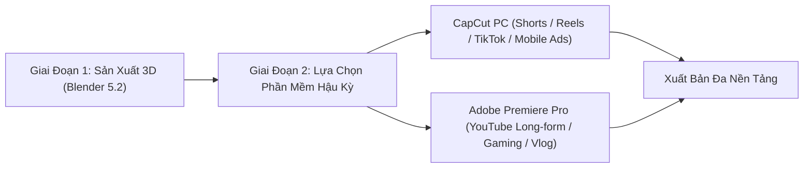

# Creative Production Suite (Blender 5.2 + CapCut PC + Premiere Pro)

Quy trình sản xuất nội dung đa phương tiện hoàn chỉnh kết hợp sức mạnh mô hình hóa 3D của **Blender 5.2 (MCP & Kho 224 Skills)** với 2 chuẩn mực dựng video đỉnh cao của **Quạ HD (CapCut PC & Adobe Premiere Pro)**.

---

## 1. Bản Đồ Quy Trình Tổng Thể (End-to-End Pipeline)

---

## 2. Giai Đoạn 1: Tiền Kỳ & Sản Xuất 3D (Blender 5.2 Pipeline)

Khi người dùng cần tạo asset 3D, phối cảnh, camera move hoặc render cảnh phim:
1. **Điều Khiển Qua MCP:** Kết nối qua cổng socket `9876` với các lệnh `get_scene_info`, `execute_blender_code`.
2. **Kho Kỹ Năng 224 Skills:** Tra cứu tại thư mục [`d:\Blender\AI\blender_skills_suite`](file:///d:/Blender/AI/blender_skills_suite) với 10 bộ chuyên sâu:
   - **G84 Core (`01_G84_Core_Blender_Skills`):** Phim trường tham chiếu 3D, Camera DOP, Ánh sáng Kelvin, Rigify.
   - **EL4CTEO Suite (`03_EL4CTEO_Blender_52_Suite`):** Slotted Actions, Cloth XPBD, PBR ORM, Geometry Nodes, Asset QA.
   - **Camera thương mại (`08_Product_Studio_Camera_Moves`):** Turntable, Crane, Dolly-Rotate, Slow-Zoom cho sản phẩm.
   - **Chỉ đạo nghệ thuật (`10_Arjun988_Art_Direction_TechArt_94`):** 94 phong cách từ Anime, Cyberpunk, Retro đến Realism.
3. **Quy Chuẩn Xuất Render để Hậu Kỳ:**
   - **Video/Animation:** Xuất chuỗi ảnh `PNG (RGBA)` nếu cần nền trong suốt (Alpha) để đè lên video; hoặc xuất `ProRes 422 / DNxHR / MP4 H.264` chất lượng cao.
   - **Multi-pass:** Xuất kèm Depth Pass, Cryptomatte nếu cần xử lý hiệu ứng phức tạp trong Premiere.

---

## 3. Giai Đoạn 2A: Dựng Video Nhanh & Mạng Xã Hội (CapCut PC - Quạ HD Workflow)
> *Gọi chi tiết bằng:* `@capcut-pc-pro-editor-quahd`

Áp dụng cho video ngắn (TikTok, Reels, Shorts), video chạy quảng cáo, hoặc vlog cần tốc độ ra video thần tốc:

1. **Setup File:** Đặt tên thư mục `01_Footage`, `02_Audio`, `03_Graphics`, `04_Render`. Khóa Ratio ngay khi tạo project (`9:16` dọc hoặc `16:9` ngang).
2. **Rough Cut Thần Tốc:**
   - Tắt `Main Track Magnet`, bật `Auto Snapping`.
   - Phím tắt Set 5: `Q` (xóa trái), `E` (xóa phải), `S` (cắt đôi tại playhead), `Backspace` giữa 2 đoạn cùng clip gốc để hàn liền.
   - Dò từng frame bằng mũi tên `Trái/Phải`, bấm `S` tại frame đầu tiên của cảnh mới.
3. **VFX & Optical Flow:**
   - Tua nhanh thoại: Bắt buộc **tắt `Keep pitch`** để giữ giọng tự nhiên.
   - Làm chậm (Slow-mo): Bắt buộc tích **`Smooth slow-mo` -> `Optical flow`** để chống giật hình.
4. **Chuẩn Âm Thanh Chuẩn dB:**
   - Lời thoại (Voiceover): `-12 dB` đến `-6 dB` (Target: `-6 dB`, cấm chạm 0 dB).
   - Nhạc nền khi có giọng: `-30 dB` đến `-15 dB`.
   - Nhạc chủ đạo không lời: `-6 dB`.
   - Luôn kéo 2 điểm chấm `Fade In` / `Fade Out` ở đầu và đuôi bài nhạc.
5. **Auto Captions 1 Dòng & Retouch:**
   - Chạy phụ đề AI -> Bật background xám đen dịu -> Cắt câu dài bằng `S` đảm bảo hiển thị tối đa **1 dòng duy nhất**.
   - Retouch: Luôn bật **`Multiple faces`** chống tuột filter. Chân dài dùng **`Manual`** khoanh từ gối xuống cổ chân.
6. **Export Chuẩn:**
   - Video dọc TikTok/Reels/Shorts: **Chỉ xuất ở `1080p Full HD`** (dù quay 4K) để tránh thuật toán nén ép gây mờ vỡ hình.

---

## 4. Giai Đoạn 2B: Dựng Video Chuyên Nghiệp (Premiere Pro - Quạ HD Workflow)
> *Gọi chi tiết bằng:* `@premiere-pro-gaming-vlog-editor-quahd`

Áp dụng cho Video dài (YouTube Long-form), Gaming Montage, Vlog du lịch/trải nghiệm, phim tài liệu, hoặc dự án nhiều layer phức tạp:

1. **Tối Ưu Hiệu Năng & Layout:**
   - Reset layout: `Alt + Shift + 0` (Windows) / `Option + Shift + 0` (Mac).
   - Preview Playback Resolution: Để `1/2` hoặc `1/4` để preview mượt mà không giật lag.
   - Kỷ luật: Nhấn `Ctrl + S` sau mỗi cụm thao tác.
2. **Cắt Thô & Điều Hướng:**
   - Lọc khoảnh khắc trên Source Monitor: Dùng `I` (`Mark In`) và `O` (`Mark Out`).
   - Kéo từ icon thước phim để lấy riêng hình ảnh, icon sóng âm để lấy riêng tiếng.
   - Điều hướng dồn lớp: Dùng `A` (`Track Select Forward Tool`), `Ripple Delete` (`Backspace` vào khoảng hở), giữ `Alt` kéo để nhân bản clip.
3. **Kỹ Thuật Đỉnh Cao:**
   - **Tua ngược:** `Right-click -> Speed/Duration -> Reverse Speed`.
   - **Nesting:** `Right-click -> Nest...` để gộp nhóm nhiều clip đè hiệu ứng tổng mà không ảnh hưởng thuộc tính gốc.
   - **Sao chép hiệu ứng:** `Ctrl + C` -> `Right-click -> Paste Attributes...`.
   - **Masking Facecam:** Mở `Effect Controls -> Opacity` -> dùng `Ellipse`, `Polygon` hoặc `Pen Tool` tách khung webcam, sau đó mới chỉnh `Scale` và `Position`.
   - **Crop:** Kéo `Video Effects -> Transform -> Crop` để cắt nhanh từng vùng màn hình.
4. **Text, Troll & Audio Ducking:**
   - Nền đơn sắc: `Project Panel -> New Item -> Color Matte`.
   - Text nổi bật: Mở `Essential Graphics` bật `Stroke` + `Shadow`.
   - Cảnh buồn/troll: Kéo `Lumetri Color -> Saturation = 0` (đen trắng).
   - **Quy tắc 2 Điểm Mốc (Anchor Keyframe) cho Audio:** Bắt buộc chấm 2 điểm Keyframe liên tiếp trên thanh Volume (Điểm 1 làm chốt giữ nguyên volume, Điểm 2 kéo xuống tạo dốc mượt).
5. **Xuất Phân Đoạn Nhanh:** Dùng `I` và `O` khoanh vùng phân đoạn trên Timeline -> nhấn `Ctrl + M` xuất thử nhanh.
