# BÁO CÁO CHI TIẾT KHO KỸ NĂNG BLENDER TẬP TRUNG (GATE 84)

> [!IMPORTANT]
> **Thư mục tập trung duy nhất:** [`D:\ĐỒ chơi Blender\KHO_SKILL_BLENDER`](file:///D:/%C4%90%E1%BB%92%20ch%C6%A1i%20Blender/KHO_SKILL_BLENDER)
> - **Tổng số Bộ kỹ năng (Groups):** `10 Bộ`
> - **Tổng số Skill độc lập (Đã giải nén & chuẩn hóa):** `224 Skills`
> - **Tổng số Script Python thực thi (`.py`):** `305 Scripts`
> - **Tổng số Tài liệu tham chiếu phụ (`.md`):** `398 Files`
> - **Danh mục JSON tra cứu tự động:** [`skill_catalog.json`](file:///D:/%C4%90%E1%BB%92%20ch%C6%A1i%20Blender/KHO_SKILL_BLENDER/skill_catalog.json)

---

## 1. SƠ ĐỒ KIẾN TRÚC KHO KỸ NĂNG BLENDER

```mermaid
flowchart TD
    ROOT["KHO_SKILL_BLENDER (224 Skills / 305 Scripts)"] --> G1["01. Gate 84 Core (9 Skills / 61 Scripts)"]
    ROOT --> G2["02. Vision Loop & MCP (3 Skills / 1 Script)"]
    ROOT --> G3["03. EL4CTEO Blender 5.2 (28 Skills / 71 Scripts)"]
    ROOT --> G4["04. Scenario 3D & Previs (25 Skills / 35 Scripts)"]
    ROOT --> G5["05. Production Router Suite (15 Skills / 48 Scripts)"]
    ROOT --> G6["06. Reference & Wireframe to 3D (30 Skills / 28 Scripts)"]
    ROOT --> G7["07. Claude Cinematic Films (3 Skills / 61 Scripts)"]
    ROOT --> G8["08. Product Studio & Camera (16 Skills)"]
    ROOT --> G9["09. Astra 2D/Anime Character (1 Skill)"]
    ROOT --> G10["10. Arjun988 Art Direction (94 Skills)"]
```

## 2. BẢNG TỔNG HỢP 10 BỘ KỸ NĂNG

| Mã Bộ | Tên Bộ Kỹ Năng | Số Skill | Số Script `.py` | Nguồn Gốc | Thế Mạnh Cốt Lõi |
| :--- | :--- | :---: | :---: | :--- | :--- |
| [`01_G84_Core_Blender_Skills`](file:///D:/%C4%90%E1%BB%92%20ch%C6%A1i%20Blender/KHO_SKILL_BLENDER/01_G84_Core_Blender_Skills) | **Bộ Cốt Lõi Gate 84** | **9** | **61** | `Gate84-Brain` | Chuẩn hóa riêng cho G84: Phim trường tham chiếu 3D, Không gian mốc 000, Diễn xuất 5.2, Camera DOP, Ánh sáng, GIS, Rigify, StableGen. |
| [`02_Vision_Loop_MCP_Controllers`](file:///D:/%C4%90%E1%BB%92%20ch%C6%A1i%20Blender/KHO_SKILL_BLENDER/02_Vision_Loop_MCP_Controllers) | **Bộ Vòng Lặp Thị Giác & MCP** | **3** | **1** | `Dream-Loop + Qwen-MM + Motion-Prompt` | Tự động chấm điểm render đối chiếu ảnh mục tiêu (`dream-loop`), gọi PolyHaven/Hunyuan3D/Rodin và chuẩn hóa đường đi máy quay. |
| [`03_EL4CTEO_Blender_52_Suite`](file:///D:/%C4%90%E1%BB%92%20ch%C6%A1i%20Blender/KHO_SKILL_BLENDER/03_EL4CTEO_Blender_52_Suite) | **Bộ Kỹ Thuật Blender 5.2 Toàn Diện** | **28** | **71** | `blender-skills-main (1).zip` | Bộ đầy đủ nhất về API Blender 5.2 (`_bpyx.py`, Slotted Actions, Cloth XPBD, Geometry Nodes, PBR, Weather FX, Baking, QA Gate). |
| [`04_Scenario_Blender_3D_Pipeline`](file:///D:/%C4%90%E1%BB%92%20ch%C6%A1i%20Blender/KHO_SKILL_BLENDER/04_Scenario_Blender_3D_Pipeline) | **Bộ Scenario Blender & 3D AI** | **25** | **35** | `skills-main.zip (Scenario)` | Thư viện hàm `bx_previs.py`, `bx_blockout.py`, `bx_rig.py`, `bx_anim.py`, `bx_kits.py` + kết nối AI 3D (Meshy, Rodin, Sparc3D, Patina, Video-to-Motion). |
| [`05_Blender_Production_Router_Suite`](file:///D:/%C4%90%E1%BB%92%20ch%C6%A1i%20Blender/KHO_SKILL_BLENDER/05_Blender_Production_Router_Suite) | **Bộ Sản Xuất Studio & GN** | **15** | **48** | `blender-production-skills-main.zip` | Có Router điều phối, kiểm định hình học nghiêm ngặt, dựng mặt cong BMesh, NPR Cycles/EEVEE (viền 2D/Anime) và tra cứu tài sản cục bộ. |
| [`06_CC_Reference_Wireframe_to_3D`](file:///D:/%C4%90%E1%BB%92%20ch%C6%A1i%20Blender/KHO_SKILL_BLENDER/06_CC_Reference_Wireframe_to_3D) | **Bộ Tái Tạo 3D Từ Ảnh & Bản Vẽ** | **30** | **28** | `cc-blender-skill-main.zip` | Chuyên dựng 3D khớp 1:1 từ bản vẽ kỹ thuật 4 góc (Front/Side/Back/Top), cắt contour-to-mesh, mascot/logo và tự động sửa sai số IoU/Landmark. |
| [`07_Claude_Cinematic_Film_Directors`](file:///D:/%C4%90%E1%BB%92%20ch%C6%A1i%20Blender/KHO_SKILL_BLENDER/07_Claude_Cinematic_Film_Directors) | **Bộ Đạo Diễn Phim Ngắn Điện Ảnh** | **3** | **61** | `claude-blender-skills-main.zip` | 61 scripts thực chiến tạo phim ngắn hoàn chỉnh: Drone FPV bay đêm vật lý thật, Phim xe hơi đêm bão tuyết 20s, Rừng siêu thực. |
| [`08_Product_Studio_Camera_Moves`](file:///D:/%C4%90%E1%BB%92%20ch%C6%A1i%20Blender/KHO_SKILL_BLENDER/08_Product_Studio_Camera_Moves) | **Bộ Quay Sản Phẩm & Camera Rig** | **16** | **0** | `blender-skills-main (2).zip` | 16 mẫu chuyển động máy quay thương mại (Turntable, Crane, Dolly-Rotate, Slow-Zoom, Whip-Loop), studio PolyHaven và xuất Three.js. |
| [`09_Astra_Anime_Character_Workflow`](file:///D:/%C4%90%E1%BB%92%20ch%C6%A1i%20Blender/KHO_SKILL_BLENDER/09_Astra_Anime_Character_Workflow) | **Bộ Nhân Vật 2D/Anime Sang 3D** | **1** | **0** | `awesome-astra-blender-characters` | Quy trình biến ảnh thiết kế nhân vật 2D thành model 3D qua 9 góc chiếu, dựng mặt/tóc/mắt anime và nghiệm thu đa góc. |
| [`10_Arjun988_Art_Direction_TechArt_94`](file:///D:/%C4%90%E1%BB%92%20ch%C6%A1i%20Blender/KHO_SKILL_BLENDER/10_Arjun988_Art_Direction_TechArt_94) | **Bộ 94 Chỉ Đạo Nghệ Thuật & TechArt** | **94** | **0** | `blender-skills-main.zip (Arjun988)` | Từ điển 94 phong cách thiết kế mỹ thuật (Art Style, Mood, Biome, Horror, Cyberpunk, Cổ trang/Wuxia, Game Genre, VFX, Compositing). |

---

## 3. BÁO CÁO CHI TIẾT TỪNG SKILL TRONG 10 BỘ (224 SKILLS)

### 01. Bộ Kỹ Năng Blender Cốt Lõi Của Gate 84 (G84 Custom & Upgraded 5.2)
- **Đường dẫn thư mục:** [`01_G84_Core_Blender_Skills`](file:///D:/%C4%90%E1%BB%92%20ch%C6%A1i%20Blender/KHO_SKILL_BLENDER/01_G84_Core_Blender_Skills)
- **Quy mô:** `9 skills` | `61 scripts (.py)` | `67 tài liệu tham chiếu (.md)`

| STT | Tên Skill (`SKILL.md`) | Số Script `.py` (Các file tiêu biểu) | Chức Năng & Ứng Dụng Thực Tế |
| :---: | :--- | :--- | :--- |
| 1 | [**`blender-animation-52`**](file:///D:/%C4%90%E1%BB%92%20ch%C6%A1i%20Blender/KHO_SKILL_BLENDER/01_G84_Core_Blender_Skills/blender-animation-52/SKILL.md) ([thư mục](file:///D:/%C4%90%E1%BB%92%20ch%C6%A1i%20Blender/KHO_SKILL_BLENDER/01_G84_Core_Blender_Skills/blender-animation-52)) | **8**: `_bpyx.py`, `animation_contact_sheet.py`, `bake_action.py`, `bx_anim.py` (+4) | Diễn xuất nhân vật & chuyển động mềm chuẩn kỹ thuật Blender 5.2 (Slotted Action API, Bezier Auto-Clamped, IK Walk Path, Retarget, chống trượt chân, Onion-Skin). |
| 2 | [**`blender-camera`**](file:///D:/%C4%90%E1%BB%92%20ch%C6%A1i%20Blender/KHO_SKILL_BLENDER/01_G84_Core_Blender_Skills/blender-camera/SKILL.md) ([thư mục](file:///D:/%C4%90%E1%BB%92%20ch%C6%A1i%20Blender/KHO_SKILL_BLENDER/01_G84_Core_Blender_Skills/blender-camera)) | **8**: `_bpyx.py`, `bx_blockout.py`, `bx_previs.py`, `bx_review.py` (+4) | Bố cục máy quay, tiêu cự 18mm–135mm, Camera Blocking, phối cảnh 2 điểm tụ (Shift-Y), trục 180 độ, DOF & previs (`bx_previs.py`, `bx_blockout.py`). |
| 3 | [**`blender-gis`**](file:///D:/%C4%90%E1%BB%92%20ch%C6%A1i%20Blender/KHO_SKILL_BLENDER/01_G84_Core_Blender_Skills/blender-gis/SKILL.md) ([thư mục](file:///D:/%C4%90%E1%BB%92%20ch%C6%A1i%20Blender/KHO_SKILL_BLENDER/01_G84_Core_Blender_Skills/blender-gis)) | **10**: `_bpyx.py`, `bx_blockout.py`, `bx_kits.py`, `gn_builder.py` (+6) | Tái tạo môi trường đô thị & dữ liệu địa lý (CRS/UTM, DEM/SRTM, OpenStreetMap, Drop to Ground, rải đạo cụ Geometry Nodes & hiệu ứng thời tiết). |
| 4 | [**`blender-lighting`**](file:///D:/%C4%90%E1%BB%92%20ch%C6%A1i%20Blender/KHO_SKILL_BLENDER/01_G84_Core_Blender_Skills/blender-lighting/SKILL.md) ([thư mục](file:///D:/%C4%90%E1%BB%92%20ch%C6%A1i%20Blender/KHO_SKILL_BLENDER/01_G84_Core_Blender_Skills/blender-lighting)) | **12**: `_bpyx.py`, `build_cycles_npr.py`, `build_eevee_npr.py`, `lightning.py` (+8) | Chiếu sáng vật lý (Sun, Area, Spot, Nishita Sky), nhiệt độ màu Kelvin, sương mù thể tích (God Rays), Light Linking & chiếu sáng hẻm đô thị Việt Nam. |
| 5 | [**`blender-rigify`**](file:///D:/%C4%90%E1%BB%92%20ch%C6%A1i%20Blender/KHO_SKILL_BLENDER/01_G84_Core_Blender_Skills/blender-rigify/SKILL.md) ([thư mục](file:///D:/%C4%90%E1%BB%92%20ch%C6%A1i%20Blender/KHO_SKILL_BLENDER/01_G84_Core_Blender_Skills/blender-rigify)) | **8**: `_bpyx.py`, `bind_mesh.py`, `bx_rig.py`, `garment.py` (+4) | Gắn xương & điều khiển nhân vật (Rigify Metarig, chuẩn bị Mesh, Bone Roll, Weight Painting, IK/FK, Facial Rigging & Pose Library). |
| 6 | [**`g84-dung-blender`**](file:///D:/%C4%90%E1%BB%92%20ch%C6%A1i%20Blender/KHO_SKILL_BLENDER/01_G84_Core_Blender_Skills/g84-dung-blender/SKILL.md) ([thư mục](file:///D:/%C4%90%E1%BB%92%20ch%C6%A1i%20Blender/KHO_SKILL_BLENDER/01_G84_Core_Blender_Skills/g84-dung-blender)) | `0` | Dựng set Blender 5.2 một chiều từ bảng không gian mốc 000, đặt điểm người/máy, đi máy bằng Scenario, xuất sheet, take và depth. |
| 7 | [**`g84-phim-truong-tham-chieu`**](file:///D:/%C4%90%E1%BB%92%20ch%C6%A1i%20Blender/KHO_SKILL_BLENDER/01_G84_Core_Blender_Skills/g84-phim-truong-tham-chieu/SKILL.md) ([thư mục](file:///D:/%C4%90%E1%BB%92%20ch%C6%A1i%20Blender/KHO_SKILL_BLENDER/01_G84_Core_Blender_Skills/g84-phim-truong-tham-chieu)) | **15**: `_bpyx.py`, `build_temple_broken_silence.py`, `bx_anim.py`, `bx_audit.py` (+11) | Đạo diễn Phim Trường 3D & Xuất Video Tham Chiếu Đa Kênh (Lit, Depth, Normal, ID Mask, Top-Down, Contact Sheet) từ kịch bản/JSON (`g84_stage_director.py`). |
| 8 | [**`g84-phu-vo-stablegen`**](file:///D:/%C4%90%E1%BB%92%20ch%C6%A1i%20Blender/KHO_SKILL_BLENDER/01_G84_Core_Blender_Skills/g84-phu-vo-stablegen/SKILL.md) ([thư mục](file:///D:/%C4%90%E1%BB%92%20ch%C6%A1i%20Blender/KHO_SKILL_BLENDER/01_G84_Core_Blender_Skills/g84-phu-vo-stablegen)) | `0` | Phủ vật liệu/texture PBR bằng StableGen + ComfyUI local cho set Blender, chỉnh màu theo canon, có ngưỡng đo sáng tự kiểm. |
| 9 | [**`g84-khong-gian`**](file:///D:/%C4%90%E1%BB%92%20ch%C6%A1i%20Blender/KHO_SKILL_BLENDER/01_G84_Core_Blender_Skills/g84-khong-gian/SKILL.md) ([thư mục](file:///D:/%C4%90%E1%BB%92%20ch%C6%A1i%20Blender/KHO_SKILL_BLENDER/01_G84_Core_Blender_Skills/g84-khong-gian)) | `0` | Bảng không gian mốc 000 — khung dữ liệu tọa độ duy nhất cho địa điểm, vật, điểm người P_, điểm máy V_ mà cả Blender lẫn Unity 6 cùng đọc. |

### 02. Bộ Điều Khiển Thị Giác Khép Kín & Đa Phương Thức (Dream-Loop, Qwen-MM, Motion-Prompt)
- **Đường dẫn thư mục:** [`02_Vision_Loop_MCP_Controllers`](file:///D:/%C4%90%E1%BB%92%20ch%C6%A1i%20Blender/KHO_SKILL_BLENDER/02_Vision_Loop_MCP_Controllers)
- **Quy mô:** `3 skills` | `1 scripts (.py)` | `7 tài liệu tham chiếu (.md)`

| STT | Tên Skill (`SKILL.md`) | Số Script `.py` (Các file tiêu biểu) | Chức Năng & Ứng Dụng Thực Tế |
| :---: | :--- | :--- | :--- |
| 1 | [**`dream-loop`**](file:///D:/%C4%90%E1%BB%92%20ch%C6%A1i%20Blender/KHO_SKILL_BLENDER/02_Vision_Loop_MCP_Controllers/dream-loop/SKILL.md) ([thư mục](file:///D:/%C4%90%E1%BB%92%20ch%C6%A1i%20Blender/KHO_SKILL_BLENDER/02_Vision_Loop_MCP_Controllers/dream-loop)) | **1**: `preview-server.py` | Vòng lặp thị giác khép kín (Pro/Plus Mode): sinh ảnh mục tiêu `.dream-loop/target.png` -> dựng 3D trên Blender -> dùng Subagent Giám khảo chấm thang 10 điểm -> tự sửa lặp lại. |
| 2 | [**`qwen-mm-plugins-blender`**](file:///D:/%C4%90%E1%BB%92%20ch%C6%A1i%20Blender/KHO_SKILL_BLENDER/02_Vision_Loop_MCP_Controllers/qwen-mm-plugins-blender/SKILL.md) ([thư mục](file:///D:/%C4%90%E1%BB%92%20ch%C6%A1i%20Blender/KHO_SKILL_BLENDER/02_Vision_Loop_MCP_Controllers/qwen-mm-plugins-blender)) | `0` | Điều khiển Blender trực tiếp qua MCP: dựng hình, tải tài sản PolyHaven/Sketchfab, sinh model 3D bằng Hunyuan3D / Hyper3D Rodin và tinh chỉnh khớp đặc tả. |
| 3 | [**`motion-prompt`**](file:///D:/%C4%90%E1%BB%92%20ch%C6%A1i%20Blender/KHO_SKILL_BLENDER/02_Vision_Loop_MCP_Controllers/motion-prompt/SKILL.md) ([thư mục](file:///D:/%C4%90%E1%BB%92%20ch%C6%A1i%20Blender/KHO_SKILL_BLENDER/02_Vision_Loop_MCP_Controllers/motion-prompt)) | `0` | Thư viện chuẩn hóa tên gọi & thông số chuyển động máy quay, chuyển cảnh, nhịp nhanh chậm (easing/timing) để biến thành mã điều khiển hoặc prompt video. |

### 03. Bộ Kỹ Năng Kỹ Thuật Blender 5.2 Toàn Diện (EL4CTEO — 28 Skills & 104 Python Scripts)
- **Đường dẫn thư mục:** [`03_EL4CTEO_Blender_52_Suite`](file:///D:/%C4%90%E1%BB%92%20ch%C6%A1i%20Blender/KHO_SKILL_BLENDER/03_EL4CTEO_Blender_52_Suite)
- **Quy mô:** `28 skills` | `71 scripts (.py)` | `15 tài liệu tham chiếu (.md)`

| STT | Tên Skill (`SKILL.md`) | Số Script `.py` (Các file tiêu biểu) | Chức Năng & Ứng Dụng Thực Tế |
| :---: | :--- | :--- | :--- |
| 1 | [**`blender-addon-development`**](file:///D:/%C4%90%E1%BB%92%20ch%C6%A1i%20Blender/KHO_SKILL_BLENDER/03_EL4CTEO_Blender_52_Suite/blender-addon-development/SKILL.md) ([thư mục](file:///D:/%C4%90%E1%BB%92%20ch%C6%A1i%20Blender/KHO_SKILL_BLENDER/03_EL4CTEO_Blender_52_Suite/blender-addon-development)) | **3**: `__init__.py`, `operators.py`, `ui.py` | Viết Add-on / Extension chuẩn Blender 5.2 (`blender_manifest.toml`, operators, panels, properties sau bản 5.0, vẽ GPU, đóng gói wheel Python). |
| 2 | [**`blender-animation`**](file:///D:/%C4%90%E1%BB%92%20ch%C6%A1i%20Blender/KHO_SKILL_BLENDER/03_EL4CTEO_Blender_52_Suite/blender-animation/SKILL.md) ([thư mục](file:///D:/%C4%90%E1%BB%92%20ch%C6%A1i%20Blender/KHO_SKILL_BLENDER/03_EL4CTEO_Blender_52_Suite/blender-animation)) | **4**: `_bpyx.py`, `bake_action.py`, `loop_check.py`, `retarget.py` | Hoạt họa Blender 5.2: Slotted/Layered Actions & Channelbag API, đặt keyframe bằng Python, đồ thị F-Curve, kiểm tra vòng lặp (loop check), NLA, retarget BVH/Mixamo. |
| 3 | [**`blender-asset-qa`**](file:///D:/%C4%90%E1%BB%92%20ch%C6%A1i%20Blender/KHO_SKILL_BLENDER/03_EL4CTEO_Blender_52_Suite/blender-asset-qa/SKILL.md) ([thư mục](file:///D:/%C4%90%E1%BB%92%20ch%C6%A1i%20Blender/KHO_SKILL_BLENDER/03_EL4CTEO_Blender_52_Suite/blender-asset-qa)) | **3**: `_bpyx.py`, `qa_check.py`, `review_shots.py` | Cổng kiểm định chất lượng bắt buộc cho lưới 3D: phát hiện trùng mặt (z-fighting), mảnh rời, ngược pháp tuyến (normals), hở lưới (non-manifold), đa giác lỗi. |
| 4 | [**`blender-character-rigging`**](file:///D:/%C4%90%E1%BB%92%20ch%C6%A1i%20Blender/KHO_SKILL_BLENDER/03_EL4CTEO_Blender_52_Suite/blender-character-rigging/SKILL.md) ([thư mục](file:///D:/%C4%90%E1%BB%92%20ch%C6%A1i%20Blender/KHO_SKILL_BLENDER/03_EL4CTEO_Blender_52_Suite/blender-character-rigging)) | **5**: `_bpyx.py`, `bind_mesh.py`, `rig_check.py`, `rigify_build.py` (+1) | Gắn xương nhân vật Blender 5.2: khớp Rigify metarig, đặt tên/hướng xương, phân lớp DEF/MCH/Control, bọc da tự động + dự phòng proxy, sửa tà áo/chi tiết. |
| 5 | [**`blender-clothing`**](file:///D:/%C4%90%E1%BB%92%20ch%C6%A1i%20Blender/KHO_SKILL_BLENDER/03_EL4CTEO_Blender_52_Suite/blender-clothing/SKILL.md) ([thư mục](file:///D:/%C4%90%E1%BB%92%20ch%C6%A1i%20Blender/KHO_SKILL_BLENDER/03_EL4CTEO_Blender_52_Suite/blender-clothing)) | **2**: `_bpyx.py`, `garment.py` | Thiết kế trang phục 3D trong Blender 5.2: tách quần áo từ vùng cơ thể, chuyển trọng số xương (skin-weight transfer), ẩn mặt cơ thể bị che, mô phỏng vải tạo nếp gấp. |
| 6 | [**`blender-core`**](file:///D:/%C4%90%E1%BB%92%20ch%C6%A1i%20Blender/KHO_SKILL_BLENDER/03_EL4CTEO_Blender_52_Suite/blender-core/SKILL.md) ([thư mục](file:///D:/%C4%90%E1%BB%92%20ch%C6%A1i%20Blender/KHO_SKILL_BLENDER/03_EL4CTEO_Blender_52_Suite/blender-core)) | **3**: `_bpyx.py`, `env_report.py`, `run_in_blender.py` | Nền tảng cốt lõi điều khiển Blender 5.2+ qua MCP hoặc CLI ngầm: thư viện `_bpyx.py`, ghi đè ngữ cảnh (context override), tra cứu node không phụ thuộc ngôn ngữ, luật API 5.x. |
| 7 | [**`blender-environment-kits`**](file:///D:/%C4%90%E1%BB%92%20ch%C6%A1i%20Blender/KHO_SKILL_BLENDER/03_EL4CTEO_Blender_52_Suite/blender-environment-kits/SKILL.md) ([thư mục](file:///D:/%C4%90%E1%BB%92%20ch%C6%A1i%20Blender/KHO_SKILL_BLENDER/03_EL4CTEO_Blender_52_Suite/blender-environment-kits)) | **4**: `_bpyx.py`, `kit_check.py`, `scatter.py`, `terrain.py` | Dựng môi trường & địa hình Blender 5.2: tạo địa hình từ nhiễu/heightmap, xói mòn, ruộng bậc thang, xuất bản đồ độ cao 16-bit + splat map, rải cây cối/đá theo độ dốc. |
| 8 | [**`blender-export-pipelines`**](file:///D:/%C4%90%E1%BB%92%20ch%C6%A1i%20Blender/KHO_SKILL_BLENDER/03_EL4CTEO_Blender_52_Suite/blender-export-pipelines/SKILL.md) ([thư mục](file:///D:/%C4%90%E1%BB%92%20ch%C6%A1i%20Blender/KHO_SKILL_BLENDER/03_EL4CTEO_Blender_52_Suite/blender-export-pipelines)) | **2**: `_bpyx.py`, `export_asset.py` | Quy trình xuất file chuẩn từ Blender 5.2 sang Roblox (FBX/glTF, R15), Unity (Humanoid FBX), Unreal (Skeletal FBX, Nanite, UCX), Godot/Web (GLB nén Draco/WebP), USD. |
| 9 | [**`blender-facial-shapekeys`**](file:///D:/%C4%90%E1%BB%92%20ch%C6%A1i%20Blender/KHO_SKILL_BLENDER/03_EL4CTEO_Blender_52_Suite/blender-facial-shapekeys/SKILL.md) ([thư mục](file:///D:/%C4%90%E1%BB%92%20ch%C6%A1i%20Blender/KHO_SKILL_BLENDER/03_EL4CTEO_Blender_52_Suite/blender-facial-shapekeys)) | **2**: `_bpyx.py`, `shapekeys.py` | Biểu cảm khuôn mặt & Shape Keys Blender 5.2: bộ 52 blendshape chuẩn ARKit, khẩu hình âm vị (visemes) nhép môi, tách trái/phải tự động, tạo điều khiển driver. |
| 10 | [**`blender-game-optimization`**](file:///D:/%C4%90%E1%BB%92%20ch%C6%A1i%20Blender/KHO_SKILL_BLENDER/03_EL4CTEO_Blender_52_Suite/blender-game-optimization/SKILL.md) ([thư mục](file:///D:/%C4%90%E1%BB%92%20ch%C6%A1i%20Blender/KHO_SKILL_BLENDER/03_EL4CTEO_Blender_52_Suite/blender-game-optimization)) | **3**: `_bpyx.py`, `make_lods.py`, `mesh_stats.py` | Tối ưu hóa tài sản 3D cho thời gian thực: ngân sách đa giác/vật liệu/xương theo nền tảng, tạo chuỗi LOD tự động, gộp vật liệu giảm draw-call, tạo hộp va chạm. |
| 11 | [**`blender-geometry-nodes`**](file:///D:/%C4%90%E1%BB%92%20ch%C6%A1i%20Blender/KHO_SKILL_BLENDER/03_EL4CTEO_Blender_52_Suite/blender-geometry-nodes/SKILL.md) ([thư mục](file:///D:/%C4%90%E1%BB%92%20ch%C6%A1i%20Blender/KHO_SKILL_BLENDER/03_EL4CTEO_Blender_52_Suite/blender-geometry-nodes)) | **2**: `_bpyx.py`, `gn_builder.py` | Geometry Nodes Blender 5.2: trường dữ liệu (fields), thuộc tính, nhân bản (instancing), vùng mô phỏng/lặp (simulation/repeat/for-each zones), lưới SDF và trình dựng node từ JSON. |
| 12 | [**`blender-hair-grooming`**](file:///D:/%C4%90%E1%BB%92%20ch%C6%A1i%20Blender/KHO_SKILL_BLENDER/03_EL4CTEO_Blender_52_Suite/blender-hair-grooming/SKILL.md) ([thư mục](file:///D:/%C4%90%E1%BB%92%20ch%C6%A1i%20Blender/KHO_SKILL_BLENDER/03_EL4CTEO_Blender_52_Suite/blender-hair-grooming)) | **2**: `_bpyx.py`, `groom.py` | Tạo tóc & lông thú trong Blender 5.2 bằng Hair Curves: sợi dẫn hướng + sợi con nội suy, gom lọn, uốn xoăn, vật liệu Principled Hair BSDF (sắc tố melanin), chuyển sang tấm tóc game. |
| 13 | [**`blender-hardsurface-modeling`**](file:///D:/%C4%90%E1%BB%92%20ch%C6%A1i%20Blender/KHO_SKILL_BLENDER/03_EL4CTEO_Blender_52_Suite/blender-hardsurface-modeling/SKILL.md) ([thư mục](file:///D:/%C4%90%E1%BB%92%20ch%C6%A1i%20Blender/KHO_SKILL_BLENDER/03_EL4CTEO_Blender_52_Suite/blender-hardsurface-modeling)) | **2**: `_bpyx.py`, `apply_stack.py` | Dựng mô hình bề mặt cứng (vũ khí, máy móc, đạo cụ): quy trình từ khối thô đến chi tiết, ngăn xếp Modifier không phá hủy (Mirror, Boolean Exact/Manifold, Bevel, Weighted Normal). |
| 14 | [**`blender-lighting-lookdev`**](file:///D:/%C4%90%E1%BB%92%20ch%C6%A1i%20Blender/KHO_SKILL_BLENDER/03_EL4CTEO_Blender_52_Suite/blender-lighting-lookdev/SKILL.md) ([thư mục](file:///D:/%C4%90%E1%BB%92%20ch%C6%A1i%20Blender/KHO_SKILL_BLENDER/03_EL4CTEO_Blender_52_Suite/blender-lighting-lookdev)) | **2**: `_bpyx.py`, `turntable.py` | Ánh sáng, máy quay & phát triển diện mạo (Look-Dev) Blender 5.2: đèn studio 3 điểm, HDRI, nắng trời ngoại cảnh, Light Linking, tiêu cự, DOF và bàn xoay trình diễn. |
| 15 | [**`blender-pbr-materials`**](file:///D:/%C4%90%E1%BB%92%20ch%C6%A1i%20Blender/KHO_SKILL_BLENDER/03_EL4CTEO_Blender_52_Suite/blender-pbr-materials/SKILL.md) ([thư mục](file:///D:/%C4%90%E1%BB%92%20ch%C6%A1i%20Blender/KHO_SKILL_BLENDER/03_EL4CTEO_Blender_52_Suite/blender-pbr-materials)) | **2**: `_bpyx.py`, `build_pbr_material.py` | Vật liệu PBR chuẩn vật lý trên Blender 5.2: quy tắc kim loại/độ nhám, không gian màu sRGB vs Non-Color, thông số phản xạ thực tế (F0), tự động nối bộ texture và đóng gói kênh ORM. |
| 16 | [**`blender-pipeline-automation`**](file:///D:/%C4%90%E1%BB%92%20ch%C6%A1i%20Blender/KHO_SKILL_BLENDER/03_EL4CTEO_Blender_52_Suite/blender-pipeline-automation/SKILL.md) ([thư mục](file:///D:/%C4%90%E1%BB%92%20ch%C6%A1i%20Blender/KHO_SKILL_BLENDER/03_EL4CTEO_Blender_52_Suite/blender-pipeline-automation)) | **2**: `_bpyx.py`, `batch_process.py` | Tự động hóa Blender 5.2 hàng loạt ở quy mô lớn: chạy dòng lệnh ngầm, chuyển đổi/kiểm kê hàng loạt thư mục `.blend/.fbx/.glb/.obj`, chia nhỏ tác vụ render. |
| 17 | [**`blender-rendering`**](file:///D:/%C4%90%E1%BB%92%20ch%C6%A1i%20Blender/KHO_SKILL_BLENDER/03_EL4CTEO_Blender_52_Suite/blender-rendering/SKILL.md) ([thư mục](file:///D:/%C4%90%E1%BB%92%20ch%C6%A1i%20Blender/KHO_SKILL_BLENDER/03_EL4CTEO_Blender_52_Suite/blender-rendering)) | **2**: `_bpyx.py`, `render_batch.py` | Kết xuất hình ảnh (Render) trên Blender 5.2 với Cycles/EEVEE/Workbench: cấu hình GPU, lấy mẫu thích ứng, khử nhiễu, quản lý màu (AgX, PBR Neutral, ACES) và Compositor 5.0. |
| 18 | [**`blender-retopology-uv`**](file:///D:/%C4%90%E1%BB%92%20ch%C6%A1i%20Blender/KHO_SKILL_BLENDER/03_EL4CTEO_Blender_52_Suite/blender-retopology-uv/SKILL.md) ([thư mục](file:///D:/%C4%90%E1%BB%92%20ch%C6%A1i%20Blender/KHO_SKILL_BLENDER/03_EL4CTEO_Blender_52_Suite/blender-retopology-uv)) | **4**: `_bpyx.py`, `auto_retopo.py`, `texel_density.py`, `uv_pack.py` | Đi lại lưới (Retopology) & trải UV trên Blender 5.2: Quadriflow, Decimate, đặt đường cắt (seam), trải phẳng giảm biến dạng, cân bằng mật độ điểm ảnh (texel density), UDIM. |
| 19 | [**`blender-scene-setup`**](file:///D:/%C4%90%E1%BB%92%20ch%C6%A1i%20Blender/KHO_SKILL_BLENDER/03_EL4CTEO_Blender_52_Suite/blender-scene-setup/SKILL.md) ([thư mục](file:///D:/%C4%90%E1%BB%92%20ch%C6%A1i%20Blender/KHO_SKILL_BLENDER/03_EL4CTEO_Blender_52_Suite/blender-scene-setup)) | **2**: `_bpyx.py`, `scene_audit.py` | Thiết lập & kiểm toán cảnh 3D theo chuẩn studio: hệ đơn vị mét thực tế, cấu trúc Collection, quy ước đặt tên (`SM_/SK_/T_/M_`), tâm vật thể, liên kết thư viện (Link/Append). |
| 20 | [**`blender-sculpting`**](file:///D:/%C4%90%E1%BB%92%20ch%C6%A1i%20Blender/KHO_SKILL_BLENDER/03_EL4CTEO_Blender_52_Suite/blender-sculpting/SKILL.md) ([thư mục](file:///D:/%C4%90%E1%BB%92%20ch%C6%A1i%20Blender/KHO_SKILL_BLENDER/03_EL4CTEO_Blender_52_Suite/blender-sculpting)) | **2**: `_bpyx.py`, `sculpt_ops.py` | Điêu khắc số (Sculpting) trên Blender 5.2: quy trình từ khối cơ bản đến chi tiết, Voxel Remesh, Dyntopo, Multires, đối xứng và các thao tác tạo khối tự động bằng code. |
| 21 | [**`blender-simulation`**](file:///D:/%C4%90%E1%BB%92%20ch%C6%A1i%20Blender/KHO_SKILL_BLENDER/03_EL4CTEO_Blender_52_Suite/blender-simulation/SKILL.md) ([thư mục](file:///D:/%C4%90%E1%BB%92%20ch%C6%A1i%20Blender/KHO_SKILL_BLENDER/03_EL4CTEO_Blender_52_Suite/blender-simulation)) | **2**: `_bpyx.py`, `sim_setup.py` | Mô phỏng vật lý Blender 5.2: vật rắn (Rigid Body), vải cổ điển và hệ thống Vải/Tóc XPBD mới trên node, chất lỏng/khói lửa Mantaflow, nướng (bake) mô phỏng thành keyframe. |
| 22 | [**`blender-stylized-npr`**](file:///D:/%C4%90%E1%BB%92%20ch%C6%A1i%20Blender/KHO_SKILL_BLENDER/03_EL4CTEO_Blender_52_Suite/blender-stylized-npr/SKILL.md) ([thư mục](file:///D:/%C4%90%E1%BB%92%20ch%C6%A1i%20Blender/KHO_SKILL_BLENDER/03_EL4CTEO_Blender_52_Suite/blender-stylized-npr)) | **2**: `_bpyx.py`, `toon_setup.py` | Phong cách hoạt hình phi thực tế (Stylized / NPR) trên Blender 5.2: đổ bóng hoạt hình (Cel/Toon shading), pháp tuyến mặt Anime, viền đen Inverted-Hull, Line Art & Freestyle. |
| 23 | [**`blender-texture-baking`**](file:///D:/%C4%90%E1%BB%92%20ch%C6%A1i%20Blender/KHO_SKILL_BLENDER/03_EL4CTEO_Blender_52_Suite/blender-texture-baking/SKILL.md) ([thư mục](file:///D:/%C4%90%E1%BB%92%20ch%C6%A1i%20Blender/KHO_SKILL_BLENDER/03_EL4CTEO_Blender_52_Suite/blender-texture-baking)) | **2**: `_bpyx.py`, `bake_maps.py` | Nướng bản đồ bề mặt (Texture Baking) bằng Cycles Blender 5.2: nướng Normal Map từ lưới chi tiết cao sang lưới thấp có lồng bao (cage), nướng AO, độ cong (Curvature), ID, ORM. |
| 24 | [**`blender-texturing`**](file:///D:/%C4%90%E1%BB%92%20ch%C6%A1i%20Blender/KHO_SKILL_BLENDER/03_EL4CTEO_Blender_52_Suite/blender-texturing/SKILL.md) ([thư mục](file:///D:/%C4%90%E1%BB%92%20ch%C6%A1i%20Blender/KHO_SKILL_BLENDER/03_EL4CTEO_Blender_52_Suite/blender-texturing)) | **3**: `_bpyx.py`, `decal.py`, `smart_material.py` | Tạo chất liệu bề mặt thông minh trên Blender 5.2: lớp mòn cạnh (edge wear), bụi bẩn khe kẽ từ mặt nạ AO/Curvature, dán decal không bị nhấp nháy mặt, tấm vật liệu dùng chung (trim sheet). |
| 25 | [**`blender-time-of-day`**](file:///D:/%C4%90%E1%BB%92%20ch%C6%A1i%20Blender/KHO_SKILL_BLENDER/03_EL4CTEO_Blender_52_Suite/blender-time-of-day/SKILL.md) ([thư mục](file:///D:/%C4%90%E1%BB%92%20ch%C6%A1i%20Blender/KHO_SKILL_BLENDER/03_EL4CTEO_Blender_52_Suite/blender-time-of-day)) | **2**: `_bpyx.py`, `scene_mood.py` | Thời gian trong ngày & khí quyển Blender 5.2: bầu trời và mặt trời chuẩn thông số cho bình minh, trưa, giờ vàng, hoàng hôn, giờ xanh, đêm trăng sao, sương mù và tia sáng (God Rays). |
| 26 | [**`blender-video-editing`**](file:///D:/%C4%90%E1%BB%92%20ch%C6%A1i%20Blender/KHO_SKILL_BLENDER/03_EL4CTEO_Blender_52_Suite/blender-video-editing/SKILL.md) ([thư mục](file:///D:/%C4%90%E1%BB%92%20ch%C6%A1i%20Blender/KHO_SKILL_BLENDER/03_EL4CTEO_Blender_52_Suite/blender-video-editing)) | **3**: `_bpyx.py`, `track_camera.py`, `vse_edit.py` | Dựng video & bám chuyển động (Motion Tracking) trong Blender 5.2 bằng Python: cắt ghép trên Video Sequencer, chuyển cảnh, chèn chữ/nhạc, giải nghiệm máy quay từ video thật. |
| 27 | [**`blender-weather-fx`**](file:///D:/%C4%90%E1%BB%92%20ch%C6%A1i%20Blender/KHO_SKILL_BLENDER/03_EL4CTEO_Blender_52_Suite/blender-weather-fx/SKILL.md) ([thư mục](file:///D:/%C4%90%E1%BB%92%20ch%C6%A1i%20Blender/KHO_SKILL_BLENDER/03_EL4CTEO_Blender_52_Suite/blender-weather-fx)) | **4**: `_bpyx.py`, `lightning.py`, `precipitation.py`, `surface_weather.py` | Hiệu ứng thời tiết trong Blender 5.2: mưa, tuyết, bụi, tro và tàn lửa lặp vô tận bằng Geometry Nodes, bề mặt ướt, vũng nước gợn sóng, lớp tuyết phủ dày và tia sét. |
| 28 | [**`blender-workflow-recipes`**](file:///D:/%C4%90%E1%BB%92%20ch%C6%A1i%20Blender/KHO_SKILL_BLENDER/03_EL4CTEO_Blender_52_Suite/blender-workflow-recipes/SKILL.md) ([thư mục](file:///D:/%C4%90%E1%BB%92%20ch%C6%A1i%20Blender/KHO_SKILL_BLENDER/03_EL4CTEO_Blender_52_Suite/blender-workflow-recipes)) | `0` | Kịch bản phối hợp liên hoàn (Playbooks) nối các kỹ năng Blender 5.2 kèm cổng kiểm duyệt QA: quy trình làm đạo cụ game, nhân vật hoàn chỉnh từ lưới AI đến gắn xương và xuất file. |

### 04. Bộ Kỹ Năng Scenario Blender & 3D AI Pipeline (Scenario Labs — 25 Skills)
- **Đường dẫn thư mục:** [`04_Scenario_Blender_3D_Pipeline`](file:///D:/%C4%90%E1%BB%92%20ch%C6%A1i%20Blender/KHO_SKILL_BLENDER/04_Scenario_Blender_3D_Pipeline)
- **Quy mô:** `25 skills` | `35 scripts (.py)` | `68 tài liệu tham chiếu (.md)`

| STT | Tên Skill (`SKILL.md`) | Số Script `.py` (Các file tiêu biểu) | Chức Năng & Ứng Dụng Thực Tế |
| :---: | :--- | :--- | :--- |
| 1 | [**`scenario-blender-animation`**](file:///D:/%C4%90%E1%BB%92%20ch%C6%A1i%20Blender/KHO_SKILL_BLENDER/04_Scenario_Blender_3D_Pipeline/scenario-blender-animation/SKILL.md) ([thư mục](file:///D:/%C4%90%E1%BB%92%20ch%C6%A1i%20Blender/KHO_SKILL_BLENDER/04_Scenario_Blender_3D_Pipeline/scenario-blender-animation)) | **1**: `bx_anim.py` | Diễn hoạt nhân vật & vật thể bằng Python theo chuẩn Scenario (`bx_anim.py`): bóng nảy, chu kỳ đi/chạy, nhảy, diễn xuất, nhép môi, liếc mắt, từ Stepped Blocking sang Spline mượt. |
| 2 | [**`scenario-blender-blockout`**](file:///D:/%C4%90%E1%BB%92%20ch%C6%A1i%20Blender/KHO_SKILL_BLENDER/04_Scenario_Blender_3D_Pipeline/scenario-blender-blockout/SKILL.md) ([thư mục](file:///D:/%C4%90%E1%BB%92%20ch%C6%A1i%20Blender/KHO_SKILL_BLENDER/04_Scenario_Blender_3D_Pipeline/scenario-blender-blockout)) | **7**: `bx_blockout.py`, `bx_kits.py`, `ex1_watchmaker.py`, `ex2_saltflat.py` (+3) | Dựng cảnh khối thô (Blockout) từ kịch bản/ảnh tham chiếu (`bx_blockout.py`) để xuất video playblast dẫn đường cho AI sinh video thực tế (Seedance, Render Video). |
| 3 | [**`scenario-blender-expert`**](file:///D:/%C4%90%E1%BB%92%20ch%C6%A1i%20Blender/KHO_SKILL_BLENDER/04_Scenario_Blender_3D_Pipeline/scenario-blender-expert/SKILL.md) ([thư mục](file:///D:/%C4%90%E1%BB%92%20ch%C6%A1i%20Blender/KHO_SKILL_BLENDER/04_Scenario_Blender_3D_Pipeline/scenario-blender-expert)) | **3**: `bx_audit.py`, `bx_gui.py`, `bx_review.py` | Kỹ năng tổng chỉ huy làm việc 3D trên Blender qua cầu nối MCP hoặc chạy ngầm: bao quát dựng hình, điêu khắc, đi lại lưới, UV, gắn xương, diễn hoạt, previs và kiểm duyệt. |
| 4 | [**`scenario-blender-export`**](file:///D:/%C4%90%E1%BB%92%20ch%C6%A1i%20Blender/KHO_SKILL_BLENDER/04_Scenario_Blender_3D_Pipeline/scenario-blender-export/SKILL.md) ([thư mục](file:///D:/%C4%90%E1%BB%92%20ch%C6%A1i%20Blender/KHO_SKILL_BLENDER/04_Scenario_Blender_3D_Pipeline/scenario-blender-export)) | **1**: `bx_export.py` | Xuất mô hình, nhân vật và chuyển động từ Blender sang Engine game, Web hoặc in 3D (FBX, glTF/GLB, USD/USDZ, STL) với kiểm tra tỷ lệ và trục tọa độ. |
| 5 | [**`scenario-blender-geometry-nodes`**](file:///D:/%C4%90%E1%BB%92%20ch%C6%A1i%20Blender/KHO_SKILL_BLENDER/04_Scenario_Blender_3D_Pipeline/scenario-blender-geometry-nodes/SKILL.md) ([thư mục](file:///D:/%C4%90%E1%BB%92%20ch%C6%A1i%20Blender/KHO_SKILL_BLENDER/04_Scenario_Blender_3D_Pipeline/scenario-blender-geometry-nodes)) | **1**: `bx_gn.py` | Xây dựng và gỡ lỗi mạng Geometry Nodes: mô hình hóa thủ tục, rải vật thể trên bề mặt, xếp mảng dọc đường cong, vòng lặp repeat/for-each và vật lý 5.2. |
| 6 | [**`scenario-blender-grease-pencil`**](file:///D:/%C4%90%E1%BB%92%20ch%C6%A1i%20Blender/KHO_SKILL_BLENDER/04_Scenario_Blender_3D_Pipeline/scenario-blender-grease-pencil/SKILL.md) ([thư mục](file:///D:/%C4%90%E1%BB%92%20ch%C6%A1i%20Blender/KHO_SKILL_BLENDER/04_Scenario_Blender_3D_Pipeline/scenario-blender-grease-pencil)) | **1**: `bx_gp.py` | Vẽ và làm hoạt hình 2D / 2.5D bằng Grease Pencil trong Blender 5.x từ Python: minh họa, hoạt hình từng khung hình, nhân vật cắt giấy (cutout), nét vẽ có lực nhấn. |
| 7 | [**`scenario-blender-hair`**](file:///D:/%C4%90%E1%BB%92%20ch%C6%A1i%20Blender/KHO_SKILL_BLENDER/04_Scenario_Blender_3D_Pipeline/scenario-blender-hair/SKILL.md) ([thư mục](file:///D:/%C4%90%E1%BB%92%20ch%C6%A1i%20Blender/KHO_SKILL_BLENDER/04_Scenario_Blender_3D_Pipeline/scenario-blender-hair)) | **1**: `bx_hair.py` | Tạo kiểu tóc nhân vật và lông thú bằng hệ thống đường cong tóc (Hair Curves) và bộ tài sản node tóc dựng sẵn của Blender. |
| 8 | [**`scenario-blender-hard-surface`**](file:///D:/%C4%90%E1%BB%92%20ch%C6%A1i%20Blender/KHO_SKILL_BLENDER/04_Scenario_Blender_3D_Pipeline/scenario-blender-hard-surface/SKILL.md) ([thư mục](file:///D:/%C4%90%E1%BB%92%20ch%C6%A1i%20Blender/KHO_SKILL_BLENDER/04_Scenario_Blender_3D_Pipeline/scenario-blender-hard-surface)) | **1**: `bx_hardsurface.py` | Dựng mô hình bề mặt cứng (tấm giáp sci-fi, vũ khí, xe cộ, rô-bốt) bằng phép cắt Boolean, vát cạnh Bevel, pháp tuyến có trọng số (Weighted Normals) và Subdivision. |
| 9 | [**`scenario-blender-lighting-rendering`**](file:///D:/%C4%90%E1%BB%92%20ch%C6%A1i%20Blender/KHO_SKILL_BLENDER/04_Scenario_Blender_3D_Pipeline/scenario-blender-lighting-rendering/SKILL.md) ([thư mục](file:///D:/%C4%90%E1%BB%92%20ch%C6%A1i%20Blender/KHO_SKILL_BLENDER/04_Scenario_Blender_3D_Pipeline/scenario-blender-lighting-rendering)) | **1**: `bx_light.py` | Chiếu sáng, kết xuất và hậu kỳ (Compositing) trong Blender: chiếu sáng nhân vật/sản phẩm, nội thất hoàng hôn/đêm, cân chỉnh EEVEE và Cycles, khử rò sáng. |
| 10 | [**`scenario-blender-previs-storyboard`**](file:///D:/%C4%90%E1%BB%92%20ch%C6%A1i%20Blender/KHO_SKILL_BLENDER/04_Scenario_Blender_3D_Pipeline/scenario-blender-previs-storyboard/SKILL.md) ([thư mục](file:///D:/%C4%90%E1%BB%92%20ch%C6%A1i%20Blender/KHO_SKILL_BLENDER/04_Scenario_Blender_3D_Pipeline/scenario-blender-previs-storyboard)) | **1**: `bx_previs.py` | Chuyển kịch bản thành Previs, bố cục cảnh quay, Storyboard hoặc Animatic (`bx_previs.py`): chia beat thành danh sách shot, chọn ống kính, quy tắc 180 độ và dựng băng hình. |
| 11 | [**`scenario-blender-retopology`**](file:///D:/%C4%90%E1%BB%92%20ch%C6%A1i%20Blender/KHO_SKILL_BLENDER/04_Scenario_Blender_3D_Pipeline/scenario-blender-retopology/SKILL.md) ([thư mục](file:///D:/%C4%90%E1%BB%92%20ch%C6%A1i%20Blender/KHO_SKILL_BLENDER/04_Scenario_Blender_3D_Pipeline/scenario-blender-retopology)) | **1**: `bx_retopo.py` | Chuyển lưới điêu khắc dày, quét 3D hoặc lưới do AI sinh ra thành lưới tứ giác (Quad) sạch phục vụ diễn hoạt hoặc tối ưu đa giác cho game. |
| 12 | [**`scenario-blender-rigging`**](file:///D:/%C4%90%E1%BB%92%20ch%C6%A1i%20Blender/KHO_SKILL_BLENDER/04_Scenario_Blender_3D_Pipeline/scenario-blender-rigging/SKILL.md) ([thư mục](file:///D:/%C4%90%E1%BB%92%20ch%C6%A1i%20Blender/KHO_SKILL_BLENDER/04_Scenario_Blender_3D_Pipeline/scenario-blender-rigging)) | **1**: `bx_rig.py` | Gắn xương nhân vật, sinh vật hoặc đạo cụ bằng Python (`bx_rig.py`): căn chỉnh Rigify metarig, xử lý lỗi 'Bone Heat Weighting failed', gắn xương quần áo và biểu cảm. |
| 13 | [**`scenario-blender-sculpting`**](file:///D:/%C4%90%E1%BB%92%20ch%C6%A1i%20Blender/KHO_SKILL_BLENDER/04_Scenario_Blender_3D_Pipeline/scenario-blender-sculpting/SKILL.md) ([thư mục](file:///D:/%C4%90%E1%BB%92%20ch%C6%A1i%20Blender/KHO_SKILL_BLENDER/04_Scenario_Blender_3D_Pipeline/scenario-blender-sculpting)) | **1**: `bx_sculpt.py` | Điêu khắc đầu, khuôn mặt, tượng bán thân hoặc sinh vật trong Blender bằng Python: tạo khối từ hình cơ bản, vạt phẳng giải phẫu (jaw, cheekbones) và thêm chi tiết. |
| 14 | [**`scenario-blender-texturing-shading`**](file:///D:/%C4%90%E1%BB%92%20ch%C6%A1i%20Blender/KHO_SKILL_BLENDER/04_Scenario_Blender_3D_Pipeline/scenario-blender-texturing-shading/SKILL.md) ([thư mục](file:///D:/%C4%90%E1%BB%92%20ch%C6%A1i%20Blender/KHO_SKILL_BLENDER/04_Scenario_Blender_3D_Pipeline/scenario-blender-texturing-shading)) | **1**: `bx_materials.py` | Tạo vật liệu PBR, bề mặt thủ tục, vết mòn cạnh, bụi bẩn, rỉ sét, dán decal và ánh xạ hộp (triplanar mapping) không cần UV cho cảnh lớn. |
| 15 | [**`scenario-blender-uv-baking`**](file:///D:/%C4%90%E1%BB%92%20ch%C6%A1i%20Blender/KHO_SKILL_BLENDER/04_Scenario_Blender_3D_Pipeline/scenario-blender-uv-baking/SKILL.md) ([thư mục](file:///D:/%C4%90%E1%BB%92%20ch%C6%A1i%20Blender/KHO_SKILL_BLENDER/04_Scenario_Blender_3D_Pipeline/scenario-blender-uv-baking)) | **1**: `bx_uvbake.py` | Trải UV, đặt đường cắt, căn thẳng và đóng gói UV, đặt mật độ texel, trải UDIM và nướng bản đồ Normal/AO/Curvature/ID từ lưới cao xuống lưới thấp. |
| 16 | [**`scenario-3d-worlds`**](file:///D:/%C4%90%E1%BB%92%20ch%C6%A1i%20Blender/KHO_SKILL_BLENDER/04_Scenario_Blender_3D_Pipeline/scenario-3d-worlds/SKILL.md) ([thư mục](file:///D:/%C4%90%E1%BB%92%20ch%C6%A1i%20Blender/KHO_SKILL_BLENDER/04_Scenario_Blender_3D_Pipeline/scenario-3d-worlds)) | `0` | Sinh thế giới 3D có thể đi dạo hoặc cảnh Gaussian Splat trên Scenario rồi đưa vào quy trình làm việc 3D. |
| 17 | [**`scenario-3d`**](file:///D:/%C4%90%E1%BB%92%20ch%C6%A1i%20Blender/KHO_SKILL_BLENDER/04_Scenario_Blender_3D_Pipeline/scenario-3d/SKILL.md) ([thư mục](file:///D:/%C4%90%E1%BB%92%20ch%C6%A1i%20Blender/KHO_SKILL_BLENDER/04_Scenario_Blender_3D_Pipeline/scenario-3d)) | `0` | Tạo và xử lý tài sản 3D qua Scenario MCP (Text-to-3D, Image-to-3D ra GLB, FBX, OBJ, STL, VOX có sẵn vật liệu PBR). |
| 18 | [**`scenario-blender-2d-animation`**](file:///D:/%C4%90%E1%BB%92%20ch%C6%A1i%20Blender/KHO_SKILL_BLENDER/04_Scenario_Blender_3D_Pipeline/scenario-blender-2d-animation/SKILL.md) ([thư mục](file:///D:/%C4%90%E1%BB%92%20ch%C6%A1i%20Blender/KHO_SKILL_BLENDER/04_Scenario_Blender_3D_Pipeline/scenario-blender-2d-animation)) | **6**: `build_scene.py`, `measure_set.py`, `prep_assets.py`, `reframe_stills.py` (+2) | Dựng cảnh cắt (cutscene) hoặc trailer game 2D đi cảnh ngang (side-scroller) có chiều sâu thị sai (parallax) trong Blender từ các tấm ảnh phẳng. |
| 19 | [**`scenario-blender`**](file:///D:/%C4%90%E1%BB%92%20ch%C6%A1i%20Blender/KHO_SKILL_BLENDER/04_Scenario_Blender_3D_Pipeline/scenario-blender/SKILL.md) ([thư mục](file:///D:/%C4%90%E1%BB%92%20ch%C6%A1i%20Blender/KHO_SKILL_BLENDER/04_Scenario_Blender_3D_Pipeline/scenario-blender)) | `0` | Kết nối trực tiếp AI Agent với phiên Blender đang mở thông qua tiện ích mở rộng Scenario for Blender (`127.0.0.1:9876`). |
| 20 | [**`scenario-meshy`**](file:///D:/%C4%90%E1%BB%92%20ch%C6%A1i%20Blender/KHO_SKILL_BLENDER/04_Scenario_Blender_3D_Pipeline/scenario-meshy/SKILL.md) ([thư mục](file:///D:/%C4%90%E1%BB%92%20ch%C6%A1i%20Blender/KHO_SKILL_BLENDER/04_Scenario_Blender_3D_Pipeline/scenario-meshy)) | `0` | Tạo và tinh chỉnh mô hình 3D bằng hệ mô hình Meshy (từ 1–4 ảnh đa góc hoặc văn bản, tạo lại lưới tứ giác, bọc lại vật liệu PBR). |
| 21 | [**`scenario-patina-retexture`**](file:///D:/%C4%90%E1%BB%92%20ch%C6%A1i%20Blender/KHO_SKILL_BLENDER/04_Scenario_Blender_3D_Pipeline/scenario-patina-retexture/SKILL.md) ([thư mục](file:///D:/%C4%90%E1%BB%92%20ch%C6%A1i%20Blender/KHO_SKILL_BLENDER/04_Scenario_Blender_3D_Pipeline/scenario-patina-retexture)) | **6**: `apply_materials.py`, `common.py`, `film.py`, `inventory.py` (+2) | Phủ lại vật liệu PBR chất lượng cao (Basecolor, Normal, Roughness, Metallic) cho mô hình GLB hoặc cảnh Blender bằng mô hình PATINA. |
| 22 | [**`scenario-rodin`**](file:///D:/%C4%90%E1%BB%92%20ch%C6%A1i%20Blender/KHO_SKILL_BLENDER/04_Scenario_Blender_3D_Pipeline/scenario-rodin/SKILL.md) ([thư mục](file:///D:/%C4%90%E1%BB%92%20ch%C6%A1i%20Blender/KHO_SKILL_BLENDER/04_Scenario_Blender_3D_Pipeline/scenario-rodin)) | `0` | Sinh mô hình 3D chất lượng cao bằng Rodin Hyper3D từ văn bản hoặc tối đa 5 ảnh đa góc nhìn với lưới tứ giác sạch. |
| 23 | [**`scenario-sparc3d`**](file:///D:/%C4%90%E1%BB%92%20ch%C6%A1i%20Blender/KHO_SKILL_BLENDER/04_Scenario_Blender_3D_Pipeline/scenario-sparc3d/SKILL.md) ([thư mục](file:///D:/%C4%90%E1%BB%92%20ch%C6%A1i%20Blender/KHO_SKILL_BLENDER/04_Scenario_Blender_3D_Pipeline/scenario-sparc3d)) | `0` | Chuyển ảnh chụp thành lưới 3D kín hoàn toàn (watertight mesh) bằng Sparc3D phục vụ làm tài sản game, AR/VR hoặc in 3D. |
| 24 | [**`scenario-video-to-motion`**](file:///D:/%C4%90%E1%BB%92%20ch%C6%A1i%20Blender/KHO_SKILL_BLENDER/04_Scenario_Blender_3D_Pipeline/scenario-video-to-motion/SKILL.md) ([thư mục](file:///D:/%C4%90%E1%BB%92%20ch%C6%A1i%20Blender/KHO_SKILL_BLENDER/04_Scenario_Blender_3D_Pipeline/scenario-video-to-motion)) | `0` | Chuyển video người thật hoặc video AI thành chuyển động xương 3D (Markerless Motion Capture) và gắn vào nhân vật FBX/GLB. |
| 25 | [**`scenario-walkable-room`**](file:///D:/%C4%90%E1%BB%92%20ch%C6%A1i%20Blender/KHO_SKILL_BLENDER/04_Scenario_Blender_3D_Pipeline/scenario-walkable-room/SKILL.md) ([thư mục](file:///D:/%C4%90%E1%BB%92%20ch%C6%A1i%20Blender/KHO_SKILL_BLENDER/04_Scenario_Blender_3D_Pipeline/scenario-walkable-room)) | `0` | Biến một bức ảnh nội thất thành căn phòng 3D hoàn chỉnh có các đồ vật 3D tách rời để tương tác và di chuyển bên trong. |

### 05. Bộ Kỹ Năng Sản Xuất Cấp Studio & Geometry Nodes (Blender Production Skills — 15 Skills & 48 Scripts)
- **Đường dẫn thư mục:** [`05_Blender_Production_Router_Suite`](file:///D:/%C4%90%E1%BB%92%20ch%C6%A1i%20Blender/KHO_SKILL_BLENDER/05_Blender_Production_Router_Suite)
- **Quy mô:** `15 skills` | `48 scripts (.py)` | `36 tài liệu tham chiếu (.md)`

| STT | Tên Skill (`SKILL.md`) | Số Script `.py` (Các file tiêu biểu) | Chức Năng & Ứng Dụng Thực Tế |
| :---: | :--- | :--- | :--- |
| 1 | [**`blender-assembly-structure`**](file:///D:/%C4%90%E1%BB%92%20ch%C6%A1i%20Blender/KHO_SKILL_BLENDER/05_Blender_Production_Router_Suite/blender-assembly-structure/SKILL.md) ([thư mục](file:///D:/%C4%90%E1%BB%92%20ch%C6%A1i%20Blender/KHO_SKILL_BLENDER/05_Blender_Production_Router_Suite/blender-assembly-structure)) | **2**: `part_graph_smoke.py`, `validate_part_graph.py` | Quy hoạch, lắp ráp và kiểm định cấu trúc vật thể nhiều bộ phận (khớp nối cơ khí, ranh giới chi tiết, tâm xoay, phân cấp cha-con, lưới mô-đun). |
| 2 | [**`blender-deformation-rigging`**](file:///D:/%C4%90%E1%BB%92%20ch%C6%A1i%20Blender/KHO_SKILL_BLENDER/05_Blender_Production_Router_Suite/blender-deformation-rigging/SKILL.md) ([thư mục](file:///D:/%C4%90%E1%BB%92%20ch%C6%A1i%20Blender/KHO_SKILL_BLENDER/05_Blender_Production_Router_Suite/blender-deformation-rigging)) | `0` | Thiết lập hệ thống biến dạng & điều khiển chuyển động (Simple Deform, Curve, Lattice, Mesh Deform, Shrinkwrap, Surface Deform, Armature, Shape Keys, Hooks). |
| 3 | [**`blender-direct-surface-modeling`**](file:///D:/%C4%90%E1%BB%92%20ch%C6%A1i%20Blender/KHO_SKILL_BLENDER/05_Blender_Production_Router_Suite/blender-direct-surface-modeling/SKILL.md) ([thư mục](file:///D:/%C4%90%E1%BB%92%20ch%C6%A1i%20Blender/KHO_SKILL_BLENDER/05_Blender_Production_Router_Suite/blender-direct-surface-modeling)) | `0` | Dựng và tinh chỉnh bề mặt 3D trực tiếp qua BMesh, chỉnh đỉnh/cạnh/mặt ngữ nghĩa, lồng điều khiển Subdivision, cắt Boolean và chạm nổi Displace. |
| 4 | [**`blender-geometry-nodes-studio`**](file:///D:/%C4%90%E1%BB%92%20ch%C6%A1i%20Blender/KHO_SKILL_BLENDER/05_Blender_Production_Router_Suite/blender-geometry-nodes-studio/SKILL.md) ([thư mục](file:///D:/%C4%90%E1%BB%92%20ch%C6%A1i%20Blender/KHO_SKILL_BLENDER/05_Blender_Production_Router_Suite/blender-geometry-nodes-studio)) | **1**: `inspect_geometry_nodes_asset.py` | Xây dựng, thanh tra và tối ưu mạng Geometry Nodes cho mô hình hóa thủ tục, nhân bản quy mô lớn, hiệu ứng mô-đun, đường cong, bầy đàn (flocks) và vùng mô phỏng. |
| 5 | [**`blender-geometry-validation`**](file:///D:/%C4%90%E1%BB%92%20ch%C6%A1i%20Blender/KHO_SKILL_BLENDER/05_Blender_Production_Router_Suite/blender-geometry-validation/SKILL.md) ([thư mục](file:///D:/%C4%90%E1%BB%92%20ch%C6%A1i%20Blender/KHO_SKILL_BLENDER/05_Blender_Production_Router_Suite/blender-geometry-validation)) | **8**: `construction_method_integration_smoke.py`, `directional_structure_integration_smoke.py`, `portal_native_component_smoke.py`, `snapshot_scene.py` (+4) | Kiểm toán kỹ thuật toàn diện cảnh và mô hình Blender: cấu trúc lưới, ma trận biến đổi, pháp tuyến, độ liên tục bề mặt, giao cắt xuyên thấu và độ ổn định mô phỏng. |
| 6 | [**`blender-lighting-analysis`**](file:///D:/%C4%90%E1%BB%92%20ch%C6%A1i%20Blender/KHO_SKILL_BLENDER/05_Blender_Production_Router_Suite/blender-lighting-analysis/SKILL.md) ([thư mục](file:///D:/%C4%90%E1%BB%92%20ch%C6%A1i%20Blender/KHO_SKILL_BLENDER/05_Blender_Production_Router_Suite/blender-lighting-analysis)) | **2**: `lighting_plan_smoke.py`, `validate_lighting_plan.py` | Phân tích ánh sáng từ ảnh tham chiếu (hướng bóng, độ dài bóng, độ mềm, ánh sáng nảy) và tái tạo hệ thống đèn Blender có kiểm chứng. |
| 7 | [**`blender-local-asset-library`**](file:///D:/%C4%90%E1%BB%92%20ch%C6%A1i%20Blender/KHO_SKILL_BLENDER/05_Blender_Production_Router_Suite/blender-local-asset-library/SKILL.md) ([thư mục](file:///D:/%C4%90%E1%BB%92%20ch%C6%A1i%20Blender/KHO_SKILL_BLENDER/05_Blender_Production_Router_Suite/blender-local-asset-library)) | **7**: `build_asset_capability_catalog.py`, `check_local_asset_sources.py`, `inspect_local_asset_blend.py`, `probe_local_asset_blend.py` (+3) | Tra cứu và kiểm tra thư viện tài sản Blender cục bộ (Blueish Asset Library / Asset Browser) ở chế độ chỉ đọc an toàn. |
| 8 | [**`blender-material-surfacing`**](file:///D:/%C4%90%E1%BB%92%20ch%C6%A1i%20Blender/KHO_SKILL_BLENDER/05_Blender_Production_Router_Suite/blender-material-surfacing/SKILL.md) ([thư mục](file:///D:/%C4%90%E1%BB%92%20ch%C6%A1i%20Blender/KHO_SKILL_BLENDER/05_Blender_Production_Router_Suite/blender-material-surfacing)) | **1**: `audit_materials.py` | Chế tác và hiệu chuẩn vật liệu cấp độ sản xuất: kim loại trần/sơn phủ, thép xước, rỉ sét, gỗ cũ/ẩm, đá, bê tông, kính, vải, nước và rêu bẩn. |
| 9 | [**`blender-npr-cycles`**](file:///D:/%C4%90%E1%BB%92%20ch%C6%A1i%20Blender/KHO_SKILL_BLENDER/05_Blender_Production_Router_Suite/blender-npr-cycles/SKILL.md) ([thư mục](file:///D:/%C4%90%E1%BB%92%20ch%C6%A1i%20Blender/KHO_SKILL_BLENDER/05_Blender_Production_Router_Suite/blender-npr-cycles)) | **1**: `build_cycles_npr.py` | Xây dựng vật liệu 3D-sang-2D trên Cycles Blender 5.2 dùng kỹ thuật bắn tia (Shader Raycast) tạo đường viền bóng (silhouette mask) kết hợp đổ bóng phẳng/hoạt hình. |
| 10 | [**`blender-npr-eevee`**](file:///D:/%C4%90%E1%BB%92%20ch%C6%A1i%20Blender/KHO_SKILL_BLENDER/05_Blender_Production_Router_Suite/blender-npr-eevee/SKILL.md) ([thư mục](file:///D:/%C4%90%E1%BB%92%20ch%C6%A1i%20Blender/KHO_SKILL_BLENDER/05_Blender_Production_Router_Suite/blender-npr-eevee)) | **1**: `build_eevee_npr.py` | Xây dựng kết xuất 3D-sang-2D thời gian thực trên EEVEE với dải sáng phân tầng rời rạc (Shader to RGB) và viền đen Geometry Nodes bám theo biến dạng xương. |
| 11 | [**`blender-procedural-systems`**](file:///D:/%C4%90%E1%BB%92%20ch%C6%A1i%20Blender/KHO_SKILL_BLENDER/05_Blender_Production_Router_Suite/blender-procedural-systems/SKILL.md) ([thư mục](file:///D:/%C4%90%E1%BB%92%20ch%C6%A1i%20Blender/KHO_SKILL_BLENDER/05_Blender_Production_Router_Suite/blender-procedural-systems)) | **3**: `blender_forced_perspective_portal_case.py`, `inspect_node_asset.py`, `render_node_asset_preview.py` | Xây dựng hệ thống lặp và sinh tự động: cầu thang/cửa sổ theo mảng (Array), tạo hình dọc đường cong Bezier/NURBS, vùng lặp Geometry Nodes và va chạm. |
| 12 | [**`blender-production-router`**](file:///D:/%C4%90%E1%BB%92%20ch%C6%A1i%20Blender/KHO_SKILL_BLENDER/05_Blender_Production_Router_Suite/blender-production-router/SKILL.md) ([thư mục](file:///D:/%C4%90%E1%BB%92%20ch%C6%A1i%20Blender/KHO_SKILL_BLENDER/05_Blender_Production_Router_Suite/blender-production-router)) | **16**: `apply_blockout_score_decision.py`, `apply_validation_decision.py`, `artifact_contract_smoke.py`, `audit_specialist_boundaries.py` (+12) | Bộ định tuyến trung tâm điều phối sản xuất Blender: tự động dò phiên bản Blender, tra cứu tài liệu chính thức, phân loại bài toán và chấm điểm qua từng cổng. |
| 13 | [**`blender-reference-reconstruction`**](file:///D:/%C4%90%E1%BB%92%20ch%C6%A1i%20Blender/KHO_SKILL_BLENDER/05_Blender_Production_Router_Suite/blender-reference-reconstruction/SKILL.md) ([thư mục](file:///D:/%C4%90%E1%BB%92%20ch%C6%A1i%20Blender/KHO_SKILL_BLENDER/05_Blender_Production_Router_Suite/blender-reference-reconstruction)) | **6**: `blockout_score_smoke.py`, `compare_reference_render.py`, `init_reference_artifacts.py`, `reference_integration_smoke.py` (+2) | Chuyển ảnh tham chiếu thành giả thuyết không gian, ràng buộc máy quay, lộ trình dựng hình và cổng đo lường sai số để tái tạo cảnh 3D khớp ảnh gốc. |
| 14 | [**`blender-scene-design`**](file:///D:/%C4%90%E1%BB%92%20ch%C6%A1i%20Blender/KHO_SKILL_BLENDER/05_Blender_Production_Router_Suite/blender-scene-design/SKILL.md) ([thư mục](file:///D:/%C4%90%E1%BB%92%20ch%C6%A1i%20Blender/KHO_SKILL_BLENDER/05_Blender_Production_Router_Suite/blender-scene-design)) | `0` | Thiết kế bố cục mỹ thuật cho cảnh 3D: phân cấp điểm nhấn (focal hierarchy), phân lớp chiều sâu (tiền/trung/hậu cảnh), luồng dẫn mắt và nhịp điệu tỷ lệ. |
| 15 | [**`blender-simulation-effects`**](file:///D:/%C4%90%E1%BB%92%20ch%C6%A1i%20Blender/KHO_SKILL_BLENDER/05_Blender_Production_Router_Suite/blender-simulation-effects/SKILL.md) ([thư mục](file:///D:/%C4%90%E1%BB%92%20ch%C6%A1i%20Blender/KHO_SKILL_BLENDER/05_Blender_Production_Router_Suite/blender-simulation-effects)) | `0` | Thiết kế, chạy thử, nướng (bake) và kiểm định hiệu ứng vật lý: Vải, Vật mềm, Vật rắn, Chất lỏng, Khói lửa, Dynamic Paint, Đại dương, Boids và Phá hủy. |

### 06. Bộ Kỹ Năng Tái Tạo 3D Từ Ảnh Tham Chiếu, Bản Vẽ Kỹ Thuật & Mascot (CC Blender Skills — 30 Skills)
- **Đường dẫn thư mục:** [`06_CC_Reference_Wireframe_to_3D`](file:///D:/%C4%90%E1%BB%92%20ch%C6%A1i%20Blender/KHO_SKILL_BLENDER/06_CC_Reference_Wireframe_to_3D)
- **Quy mô:** `30 skills` | `28 scripts (.py)` | `26 tài liệu tham chiếu (.md)`

| STT | Tên Skill (`SKILL.md`) | Số Script `.py` (Các file tiêu biểu) | Chức Năng & Ứng Dụng Thực Tế |
| :---: | :--- | :--- | :--- |
| 1 | [**`animation-quality-gate`**](file:///D:/%C4%90%E1%BB%92%20ch%C6%A1i%20Blender/KHO_SKILL_BLENDER/06_CC_Reference_Wireframe_to_3D/animation-quality-gate/SKILL.md) ([thư mục](file:///D:/%C4%90%E1%BB%92%20ch%C6%A1i%20Blender/KHO_SKILL_BLENDER/06_CC_Reference_Wireframe_to_3D/animation-quality-gate)) | **1**: `animation_contact_sheet.py` | Cổng kiểm duyệt chất lượng chuyển động: xuất bảng Contact Sheet nhiều khung hình, kiểm tra bóng dáng (silhouette), phát hiện xuyên thấu lưới và giật khung hình. |
| 2 | [**`atlas-uv-fitting`**](file:///D:/%C4%90%E1%BB%92%20ch%C6%A1i%20Blender/KHO_SKILL_BLENDER/06_CC_Reference_Wireframe_to_3D/atlas-uv-fitting/SKILL.md) ([thư mục](file:///D:/%C4%90%E1%BB%92%20ch%C6%A1i%20Blender/KHO_SKILL_BLENDER/06_CC_Reference_Wireframe_to_3D/atlas-uv-fitting)) | **2**: `atlas_region_detector.py`, `atlas_region_mapper.py` | Tự động nhận diện các vùng trên tấm Texture Atlas và ánh xạ từng bộ phận mô hình khớp khít vào đúng vùng UV tương ứng. |
| 3 | [**`blender-animation`**](file:///D:/%C4%90%E1%BB%92%20ch%C6%A1i%20Blender/KHO_SKILL_BLENDER/06_CC_Reference_Wireframe_to_3D/blender-animation/SKILL.md) ([thư mục](file:///D:/%C4%90%E1%BB%92%20ch%C6%A1i%20Blender/KHO_SKILL_BLENDER/06_CC_Reference_Wireframe_to_3D/blender-animation)) | `0` | Tạo chuyển động cho vật thể, máy quay, đèn và thuộc tính trong Blender (Keyframes, F-Curves, nội suy Bezier/Linear/Constant, đi theo đường dẫn). |
| 4 | [**`blender-cameras`**](file:///D:/%C4%90%E1%BB%92%20ch%C6%A1i%20Blender/KHO_SKILL_BLENDER/06_CC_Reference_Wireframe_to_3D/blender-cameras/SKILL.md) ([thư mục](file:///D:/%C4%90%E1%BB%92%20ch%C6%A1i%20Blender/KHO_SKILL_BLENDER/06_CC_Reference_Wireframe_to_3D/blender-cameras)) | `0` | Thiết lập máy quay điện ảnh trong Blender: tiêu cự, độ sâu trường ảnh (f-stop / vật thể lấy nét), bố cục quy tắc 1/3 và chuyển động máy quay. |
| 5 | [**`blender-export`**](file:///D:/%C4%90%E1%BB%92%20ch%C6%A1i%20Blender/KHO_SKILL_BLENDER/06_CC_Reference_Wireframe_to_3D/blender-export/SKILL.md) ([thư mục](file:///D:/%C4%90%E1%BB%92%20ch%C6%A1i%20Blender/KHO_SKILL_BLENDER/06_CC_Reference_Wireframe_to_3D/blender-export)) | **2**: `collision_preflight.py`, `multires_bake_export.py` | Xuất cảnh Blender sang glTF/GLB (Web/AR), FBX (Engine game), OBJ, USD (VFX) và STL (in 3D) kèm kiểm tra vật liệu và hoạt họa. |
| 6 | [**`blender-lighting`**](file:///D:/%C4%90%E1%BB%92%20ch%C6%A1i%20Blender/KHO_SKILL_BLENDER/06_CC_Reference_Wireframe_to_3D/blender-lighting/SKILL.md) ([thư mục](file:///D:/%C4%90%E1%BB%92%20ch%C6%A1i%20Blender/KHO_SKILL_BLENDER/06_CC_Reference_Wireframe_to_3D/blender-lighting)) | `0` | Chiếu sáng cảnh 3D chuyên nghiệp: hệ thống 3 nguồn sáng, môi trường HDRI, ánh sáng kịch tính/điện ảnh, sương mù thể tích và nhiệt độ màu. |
| 7 | [**`blender-materials`**](file:///D:/%C4%90%E1%BB%92%20ch%C6%A1i%20Blender/KHO_SKILL_BLENDER/06_CC_Reference_Wireframe_to_3D/blender-materials/SKILL.md) ([thư mục](file:///D:/%C4%90%E1%BB%92%20ch%C6%A1i%20Blender/KHO_SKILL_BLENDER/06_CC_Reference_Wireframe_to_3D/blender-materials)) | `0` | Tạo và gán vật liệu PBR qua Principled BSDF (kim loại, kính, nhựa, vải, da, phát sáng, tán xạ dưới bề mặt SSS và trộn node thủ tục). |
| 8 | [**`blender-modeling`**](file:///D:/%C4%90%E1%BB%92%20ch%C6%A1i%20Blender/KHO_SKILL_BLENDER/06_CC_Reference_Wireframe_to_3D/blender-modeling/SKILL.md) ([thư mục](file:///D:/%C4%90%E1%BB%92%20ch%C6%A1i%20Blender/KHO_SKILL_BLENDER/06_CC_Reference_Wireframe_to_3D/blender-modeling)) | `0` | Tạo và chỉnh sửa lưới 3D bằng các khối cơ bản, mô hình bề mặt cứng, ngăn xếp Modifier (Bevel, Subdivision, Boolean, Mirror, Array, Solidify) và BMesh. |
| 9 | [**`blender-pro-workflow`**](file:///D:/%C4%90%E1%BB%92%20ch%C6%A1i%20Blender/KHO_SKILL_BLENDER/06_CC_Reference_Wireframe_to_3D/blender-pro-workflow/SKILL.md) ([thư mục](file:///D:/%C4%90%E1%BB%92%20ch%C6%A1i%20Blender/KHO_SKILL_BLENDER/06_CC_Reference_Wireframe_to_3D/blender-pro-workflow)) | `0` | Quy trình sản xuất chuẩn từ đầu đến cuối: Khối thô (Block-out) -> Máy quay -> Ánh sáng -> Hình khối -> Vật liệu -> Chi tiết -> Kết xuất -> Hậu kỳ -> Xuất file. |
| 10 | [**`blender-rendering`**](file:///D:/%C4%90%E1%BB%92%20ch%C6%A1i%20Blender/KHO_SKILL_BLENDER/06_CC_Reference_Wireframe_to_3D/blender-rendering/SKILL.md) ([thư mục](file:///D:/%C4%90%E1%BB%92%20ch%C6%A1i%20Blender/KHO_SKILL_BLENDER/06_CC_Reference_Wireframe_to_3D/blender-rendering)) | `0` | Kết xuất cảnh Blender với cấu hình tối ưu cho Cycles (chân thực) và EEVEE (tốc độ cao/hoạt hình), khử nhiễu OptiX/OIDN và quản lý màu AgX/Filmic. |
| 11 | [**`blender-skill-harmonizer`**](file:///D:/%C4%90%E1%BB%92%20ch%C6%A1i%20Blender/KHO_SKILL_BLENDER/06_CC_Reference_Wireframe_to_3D/blender-skill-harmonizer/SKILL.md) ([thư mục](file:///D:/%C4%90%E1%BB%92%20ch%C6%A1i%20Blender/KHO_SKILL_BLENDER/06_CC_Reference_Wireframe_to_3D/blender-skill-harmonizer)) | **1**: `skill_graph_audit.py` | Điều phối và kết hợp nhiều kỹ năng Blender cùng lúc theo thứ tự ưu tiên rõ ràng, bàn giao dữ liệu trung gian và giải quyết xung đột. |
| 12 | [**`blender-uv-texturing`**](file:///D:/%C4%90%E1%BB%92%20ch%C6%A1i%20Blender/KHO_SKILL_BLENDER/06_CC_Reference_Wireframe_to_3D/blender-uv-texturing/SKILL.md) ([thư mục](file:///D:/%C4%90%E1%BB%92%20ch%C6%A1i%20Blender/KHO_SKILL_BLENDER/06_CC_Reference_Wireframe_to_3D/blender-uv-texturing)) | `0` | Trải UV, ánh xạ Atlas, chiếu texture từ góc máy, dán nhãn Decal trong suốt (alpha decals), nướng bản đồ sáng và chuẩn bị tài sản xuất glTF/GLB. |
| 13 | [**`closed-surface-uv-coverage`**](file:///D:/%C4%90%E1%BB%92%20ch%C6%A1i%20Blender/KHO_SKILL_BLENDER/06_CC_Reference_Wireframe_to_3D/closed-surface-uv-coverage/SKILL.md) ([thư mục](file:///D:/%C4%90%E1%BB%92%20ch%C6%A1i%20Blender/KHO_SKILL_BLENDER/06_CC_Reference_Wireframe_to_3D/closed-surface-uv-coverage)) | **1**: `surface_texture_coverage_audit.py` | Đảm bảo texture và decal phủ kín toàn bộ các mặt nhìn thấy của vật thể kín (mặt trước, mặt sau và thành bên) không bị kéo giãn. |
| 14 | [**`contour-to-mesh`**](file:///D:/%C4%90%E1%BB%92%20ch%C6%A1i%20Blender/KHO_SKILL_BLENDER/06_CC_Reference_Wireframe_to_3D/contour-to-mesh/SKILL.md) ([thư mục](file:///D:/%C4%90%E1%BB%92%20ch%C6%A1i%20Blender/KHO_SKILL_BLENDER/06_CC_Reference_Wireframe_to_3D/contour-to-mesh)) | **2**: `mask_to_mesh_recipe.py`, `source_locked_skin_recipe.py` | Dựng lưới 3D trực tiếp từ đường viền (contour/mask) trích xuất từ ảnh 2D thay vì ghép khối thô, dùng để tái tạo chuẩn 1:1 linh vật (mascot), logo, cánh hoa. |
| 15 | [**`fit-repair-optimizer`**](file:///D:/%C4%90%E1%BB%92%20ch%C6%A1i%20Blender/KHO_SKILL_BLENDER/06_CC_Reference_Wireframe_to_3D/fit-repair-optimizer/SKILL.md) ([thư mục](file:///D:/%C4%90%E1%BB%92%20ch%C6%A1i%20Blender/KHO_SKILL_BLENDER/06_CC_Reference_Wireframe_to_3D/fit-repair-optimizer)) | **1**: `fit_repair_queue.py` | Chuyển báo cáo sai lệch đa góc nhìn thành hàng đợi sửa chữa tuần tự để căn chỉnh mô hình 3D khớp tuyệt đối với bản mẫu gốc. |
| 16 | [**`landmark-fit-repair`**](file:///D:/%C4%90%E1%BB%92%20ch%C6%A1i%20Blender/KHO_SKILL_BLENDER/06_CC_Reference_Wireframe_to_3D/landmark-fit-repair/SKILL.md) ([thư mục](file:///D:/%C4%90%E1%BB%92%20ch%C6%A1i%20Blender/KHO_SKILL_BLENDER/06_CC_Reference_Wireframe_to_3D/landmark-fit-repair)) | **1**: `landmark_fit_report.py` | Kiểm tra và sửa mô hình 3D dựa trên các điểm mốc giải phẫu/thiết kế định danh (mắt, miệng, đầu lá, góc vỏ, tâm hào quang) khi khung bao (bbox) chưa đủ chính xác. |
| 17 | [**`mascot-logo-reconstruction`**](file:///D:/%C4%90%E1%BB%92%20ch%C6%A1i%20Blender/KHO_SKILL_BLENDER/06_CC_Reference_Wireframe_to_3D/mascot-logo-reconstruction/SKILL.md) ([thư mục](file:///D:/%C4%90%E1%BB%92%20ch%C6%A1i%20Blender/KHO_SKILL_BLENDER/06_CC_Reference_Wireframe_to_3D/mascot-logo-reconstruction)) | `0` | Quy trình có cổng chặn (fail-gated) chuyên tái tạo 3D chuẩn 1:1 cho linh vật thương hiệu (Mascot), Logo và nhân vật phẳng từ bản vẽ nét và bộ texture. |
| 18 | [**`multiview-constraint-solver`**](file:///D:/%C4%90%E1%BB%92%20ch%C6%A1i%20Blender/KHO_SKILL_BLENDER/06_CC_Reference_Wireframe_to_3D/multiview-constraint-solver/SKILL.md) ([thư mục](file:///D:/%C4%90%E1%BB%92%20ch%C6%A1i%20Blender/KHO_SKILL_BLENDER/06_CC_Reference_Wireframe_to_3D/multiview-constraint-solver)) | **1**: `view_constraint_report.py` | Giải hệ ràng buộc hình học giữa 4 hình chiếu vuông góc (Trước/Bên/Sau/Trên) để kiểm tra tính nhất quán 3D trước khi dựng lưới. |
| 19 | [**`multiview-fit-loop`**](file:///D:/%C4%90%E1%BB%92%20ch%C6%A1i%20Blender/KHO_SKILL_BLENDER/06_CC_Reference_Wireframe_to_3D/multiview-fit-loop/SKILL.md) ([thư mục](file:///D:/%C4%90%E1%BB%92%20ch%C6%A1i%20Blender/KHO_SKILL_BLENDER/06_CC_Reference_Wireframe_to_3D/multiview-fit-loop)) | **1**: `multiview_fit_report.py` | Vòng lặp So sánh -> Điều chỉnh -> Lặp lại cho đến khi hình chiếu của mô hình 3D khớp khít với các bản vẽ Trước/Bên/Sau/Trên được cung cấp. |
| 20 | [**`orbital-hud-motion`**](file:///D:/%C4%90%E1%BB%92%20ch%C6%A1i%20Blender/KHO_SKILL_BLENDER/06_CC_Reference_Wireframe_to_3D/orbital-hud-motion/SKILL.md) ([thư mục](file:///D:/%C4%90%E1%BB%92%20ch%C6%A1i%20Blender/KHO_SKILL_BLENDER/06_CC_Reference_Wireframe_to_3D/orbital-hud-motion)) | **1**: `orbit_layout_manifest.py` | Tạo chuyển động vòng hào quang, HUD xoay quanh vật thể 3D từ các cung tròn, chấm, nét đứt với hiệu ứng thị sai mượt mà. |
| 21 | [**`orthographic-registration`**](file:///D:/%C4%90%E1%BB%92%20ch%C6%A1i%20Blender/KHO_SKILL_BLENDER/06_CC_Reference_Wireframe_to_3D/orthographic-registration/SKILL.md) ([thư mục](file:///D:/%C4%90%E1%BB%92%20ch%C6%A1i%20Blender/KHO_SKILL_BLENDER/06_CC_Reference_Wireframe_to_3D/orthographic-registration)) | **1**: `register_views.py` | Đăng ký và đồng bộ hệ tọa độ chung trong Blender cho 4 hình chiếu trực giao (Front, Side, Back, Top) trước khi dựng hình. |
| 22 | [**`quality-refinement-autoloop`**](file:///D:/%C4%90%E1%BB%92%20ch%C6%A1i%20Blender/KHO_SKILL_BLENDER/06_CC_Reference_Wireframe_to_3D/quality-refinement-autoloop/SKILL.md) ([thư mục](file:///D:/%C4%90%E1%BB%92%20ch%C6%A1i%20Blender/KHO_SKILL_BLENDER/06_CC_Reference_Wireframe_to_3D/quality-refinement-autoloop)) | **3**: `ralph_autoloop_plan.py`, `release_readiness_check.py`, `sanitize_skill_contributions.py` | Vòng lặp tự động chẩn đoán lỗi và nâng cấp chất lượng khi kết quả render chưa đạt yêu cầu hoặc trượt cổng kiểm định. |
| 23 | [**`reference-analysis-validator`**](file:///D:/%C4%90%E1%BB%92%20ch%C6%A1i%20Blender/KHO_SKILL_BLENDER/06_CC_Reference_Wireframe_to_3D/reference-analysis-validator/SKILL.md) ([thư mục](file:///D:/%C4%90%E1%BB%92%20ch%C6%A1i%20Blender/KHO_SKILL_BLENDER/06_CC_Reference_Wireframe_to_3D/reference-analysis-validator)) | **2**: `reference_manifest_compiler.py`, `render_overlay_validator.py` | Đo đạc và kiểm chứng thông số ảnh tham chiếu, bản vẽ nét, tấm texture và bản render Blender trước khi công nhận đạt chuẩn 1:1. |
| 24 | [**`reference-look-calibration`**](file:///D:/%C4%90%E1%BB%92%20ch%C6%A1i%20Blender/KHO_SKILL_BLENDER/06_CC_Reference_Wireframe_to_3D/reference-look-calibration/SKILL.md) ([thư mục](file:///D:/%C4%90%E1%BB%92%20ch%C6%A1i%20Blender/KHO_SKILL_BLENDER/06_CC_Reference_Wireframe_to_3D/reference-look-calibration)) | **1**: `look_fit_report.py` | Hiệu chuẩn màu sắc, độ sáng, độ bão hòa, phát sáng (glow) và vật liệu Blender khớp với thông số thống kê của ảnh gốc. |
| 25 | [**`reference-to-3d`**](file:///D:/%C4%90%E1%BB%92%20ch%C6%A1i%20Blender/KHO_SKILL_BLENDER/06_CC_Reference_Wireframe_to_3D/reference-to-3d/SKILL.md) ([thư mục](file:///D:/%C4%90%E1%BB%92%20ch%C6%A1i%20Blender/KHO_SKILL_BLENDER/06_CC_Reference_Wireframe_to_3D/reference-to-3d)) | **2**: `silhouette_validator.py`, `template_analyzer.py` | Tái tạo mô hình Blender từ bảng thiết kế nhân vật/sản phẩm, bộ nhận diện thương hiệu và hình chiếu đa góc ưu tiên độ giống thị giác cao nhất. |
| 26 | [**`source-part-segmentation`**](file:///D:/%C4%90%E1%BB%92%20ch%C6%A1i%20Blender/KHO_SKILL_BLENDER/06_CC_Reference_Wireframe_to_3D/source-part-segmentation/SKILL.md) ([thư mục](file:///D:/%C4%90%E1%BB%92%20ch%C6%A1i%20Blender/KHO_SKILL_BLENDER/06_CC_Reference_Wireframe_to_3D/source-part-segmentation)) | **2**: `seeded_part_masks.py`, `segment_source_parts.py` | Phân tách các bộ phận chồng lấp nhau trên ảnh gốc, bản vẽ nét và tấm texture trước khi dựng từng phần thành lưới 3D. |
| 27 | [**`text-to-blender`**](file:///D:/%C4%90%E1%BB%92%20ch%C6%A1i%20Blender/KHO_SKILL_BLENDER/06_CC_Reference_Wireframe_to_3D/text-to-blender/SKILL.md) ([thư mục](file:///D:/%C4%90%E1%BB%92%20ch%C6%A1i%20Blender/KHO_SKILL_BLENDER/06_CC_Reference_Wireframe_to_3D/text-to-blender)) | `0` | Điều khiển Blender từ ngôn ngữ tự nhiên qua MCP, tự động phân luồng yêu cầu dựng cảnh hoặc tái tạo từ bản vẽ sang các kỹ năng chuyên môn. |
| 28 | [**`texture-driven-mesh-fitting`**](file:///D:/%C4%90%E1%BB%92%20ch%C6%A1i%20Blender/KHO_SKILL_BLENDER/06_CC_Reference_Wireframe_to_3D/texture-driven-mesh-fitting/SKILL.md) ([thư mục](file:///D:/%C4%90%E1%BB%92%20ch%C6%A1i%20Blender/KHO_SKILL_BLENDER/06_CC_Reference_Wireframe_to_3D/texture-driven-mesh-fitting)) | **1**: `contour_correspondence_report.py` | Uốn biên dạng lưới 3D khớp 1:1 với đường viền của hình vẽ trên tấm texture/decal trước khi hoàn thiện UV. |
| 29 | [**`texture-state-animation`**](file:///D:/%C4%90%E1%BB%92%20ch%C6%A1i%20Blender/KHO_SKILL_BLENDER/06_CC_Reference_Wireframe_to_3D/texture-state-animation/SKILL.md) ([thư mục](file:///D:/%C4%90%E1%BB%92%20ch%C6%A1i%20Blender/KHO_SKILL_BLENDER/06_CC_Reference_Wireframe_to_3D/texture-state-animation)) | **1**: `texture_transition_plan.py` | Thiết kế hiệu ứng chuyển đổi trạng thái bề mặt/biểu cảm bằng texture trên mô hình 3D mượt mà, không bị nhấp nháy hay lệch vị trí. |
| 30 | [**`wireframe-to-3d`**](file:///D:/%C4%90%E1%BB%92%20ch%C6%A1i%20Blender/KHO_SKILL_BLENDER/06_CC_Reference_Wireframe_to_3D/wireframe-to-3d/SKILL.md) ([thư mục](file:///D:/%C4%90%E1%BB%92%20ch%C6%A1i%20Blender/KHO_SKILL_BLENDER/06_CC_Reference_Wireframe_to_3D/wireframe-to-3d)) | **1**: `wireframe_analyzer.py` | Chuyển bản vẽ kỹ thuật nét mảnh 2D (PNG) thành mô hình 3D hoàn chỉnh trong Blender và xuất ra glTF/GLB. |

### 07. Bộ Kỹ Năng Đạo Diễn Phim Ngắn Điện Ảnh Trên Blender (Claude Blender Skills — 3 Skills & 61 Scripts)
- **Đường dẫn thư mục:** [`07_Claude_Cinematic_Film_Directors`](file:///D:/%C4%90%E1%BB%92%20ch%C6%A1i%20Blender/KHO_SKILL_BLENDER/07_Claude_Cinematic_Film_Directors)
- **Quy mô:** `3 skills` | `61 scripts (.py)` | `10 tài liệu tham chiếu (.md)`

| STT | Tên Skill (`SKILL.md`) | Số Script `.py` (Các file tiêu biểu) | Chức Năng & Ứng Dụng Thực Tế |
| :---: | :--- | :--- | :--- |
| 1 | [**`blender-car-film`**](file:///D:/%C4%90%E1%BB%92%20ch%C6%A1i%20Blender/KHO_SKILL_BLENDER/07_Claude_Cinematic_Film_Directors/blender-car-film/SKILL.md) ([thư mục](file:///D:/%C4%90%E1%BB%92%20ch%C6%A1i%20Blender/KHO_SKILL_BLENDER/07_Claude_Cinematic_Film_Directors/blender-car-film)) | **25**: `01_world.py`, `02_car.py`, `03_rig.py`, `04_set.py` (+21) | Đạo diễn phim ngắn điện ảnh ~20 giây (6 cảnh quay xe hơi chạy trong đêm bão tuyết, tải model xe thật, dựng bối cảnh bằng Python, hạt tuyết rơi, âm thanh & giọng nói). |
| 2 | [**`blender-film`**](file:///D:/%C4%90%E1%BB%92%20ch%C6%A1i%20Blender/KHO_SKILL_BLENDER/07_Claude_Cinematic_Film_Directors/blender-film/SKILL.md) ([thư mục](file:///D:/%C4%90%E1%BB%92%20ch%C6%A1i%20Blender/KHO_SKILL_BLENDER/07_Claude_Cinematic_Film_Directors/blender-film)) | **18**: `01_swing_sim.py`, `02_path_empty.py`, `03_camera.py`, `03b_camera_noise.py` (+14) | Đạo diễn cảnh quay FPV Drone bay xuyên thành phố ban đêm 10 giây siêu thực: từ Storyboard, quy hoạch phố, đường bay có quán tính vật lý thật, ánh sáng đêm đến thiết kế âm thanh. |
| 3 | [**`blender-forest`**](file:///D:/%C4%90%E1%BB%92%20ch%C6%A1i%20Blender/KHO_SKILL_BLENDER/07_Claude_Cinematic_Film_Directors/blender-forest/SKILL.md) ([thư mục](file:///D:/%C4%90%E1%BB%92%20ch%C6%A1i%20Blender/KHO_SKILL_BLENDER/07_Claude_Cinematic_Film_Directors/blender-forest)) | **18**: `audit_blend.py`, `bench.py`, `build_car.py`, `build_path.py` (+14) | Dựng môi trường rừng tự nhiên siêu thực có xe chạy xuyên rừng: hệ thống rải cây cối/thảm thực vật riêng, ánh sáng nắng xuyên tán lá và chuyển động máy quay. |

### 08. Bộ Kỹ Năng Quay Sản Phẩm, PolyHaven Studio & Chuyển Động Máy Quay (16 Skills)
- **Đường dẫn thư mục:** [`08_Product_Studio_Camera_Moves`](file:///D:/%C4%90%E1%BB%92%20ch%C6%A1i%20Blender/KHO_SKILL_BLENDER/08_Product_Studio_Camera_Moves)
- **Quy mô:** `16 skills` | `0 scripts (.py)` | `0 tài liệu tham chiếu (.md)`

| STT | Tên Skill (`SKILL.md`) | Số Script `.py` (Các file tiêu biểu) | Chức Năng & Ứng Dụng Thực Tế |
| :---: | :--- | :--- | :--- |
| 1 | [**`blender-toolkit`**](file:///D:/%C4%90%E1%BB%92%20ch%C6%A1i%20Blender/KHO_SKILL_BLENDER/08_Product_Studio_Camera_Moves/blender-toolkit/SKILL.md) ([thư mục](file:///D:/%C4%90%E1%BB%92%20ch%C6%A1i%20Blender/KHO_SKILL_BLENDER/08_Product_Studio_Camera_Moves/blender-toolkit)) | `0` | Bộ công cụ tự động hóa thao tác tạo khối, quản lý vật liệu và chuyển đổi hoạt họa Mixamo thời gian thực qua WebSocket/MCP. |
| 2 | [**`crane-shot`**](file:///D:/%C4%90%E1%BB%92%20ch%C6%A1i%20Blender/KHO_SKILL_BLENDER/08_Product_Studio_Camera_Moves/crane-shot/SKILL.md) ([thư mục](file:///D:/%C4%90%E1%BB%92%20ch%C6%A1i%20Blender/KHO_SKILL_BLENDER/08_Product_Studio_Camera_Moves/crane-shot)) | `0` | Chuyển động máy quay cần cẩu (Crane Shot): máy bắt đầu từ góc thấp nâng dần lên cao để hé lộ toàn bộ sản phẩm trên bục. |
| 3 | [**`dolly-rotate`**](file:///D:/%C4%90%E1%BB%92%20ch%C6%A1i%20Blender/KHO_SKILL_BLENDER/08_Product_Studio_Camera_Moves/dolly-rotate/SKILL.md) ([thư mục](file:///D:/%C4%90%E1%BB%92%20ch%C6%A1i%20Blender/KHO_SKILL_BLENDER/08_Product_Studio_Camera_Moves/dolly-rotate)) | `0` | Chuyển động máy quay vừa tiến vào gần vừa xoay quanh sản phẩm (Dolly-Rotate), tạo cảm giác năng động hơn cú zoom thẳng. |
| 4 | [**`dynamic-full-loop`**](file:///D:/%C4%90%E1%BB%92%20ch%C6%A1i%20Blender/KHO_SKILL_BLENDER/08_Product_Studio_Camera_Moves/dynamic-full-loop/SKILL.md) ([thư mục](file:///D:/%C4%90%E1%BB%92%20ch%C6%A1i%20Blender/KHO_SKILL_BLENDER/08_Product_Studio_Camera_Moves/dynamic-full-loop)) | `0` | Vòng quay máy biến tốc (Speed-Ramped Loop): lướt chậm ở từng mặt chính của sản phẩm và vút nhanh (whip pan) giữa các mặt, khoe trọn 6 góc kể cả trên/dưới. |
| 5 | [**`image-to-3d`**](file:///D:/%C4%90%E1%BB%92%20ch%C6%A1i%20Blender/KHO_SKILL_BLENDER/08_Product_Studio_Camera_Moves/image-to-3d/SKILL.md) ([thư mục](file:///D:/%C4%90%E1%BB%92%20ch%C6%A1i%20Blender/KHO_SKILL_BLENDER/08_Product_Studio_Camera_Moves/image-to-3d)) | `0` | Chuyển một bức ảnh chụp thành mô hình 3D qua Meshy API và tự động nhập thẳng vào cảnh Blender qua MCP. |
| 6 | [**`multi-image-to-3d`**](file:///D:/%C4%90%E1%BB%92%20ch%C6%A1i%20Blender/KHO_SKILL_BLENDER/08_Product_Studio_Camera_Moves/multi-image-to-3d/SKILL.md) ([thư mục](file:///D:/%C4%90%E1%BB%92%20ch%C6%A1i%20Blender/KHO_SKILL_BLENDER/08_Product_Studio_Camera_Moves/multi-image-to-3d)) | `0` | Chuyển 1–4 bức ảnh chụp từ nhiều góc của cùng một vật thể thành mô hình 3D độ chính xác cao và nhập vào Blender. |
| 7 | [**`perfect-loop`**](file:///D:/%C4%90%E1%BB%92%20ch%C6%A1i%20Blender/KHO_SKILL_BLENDER/08_Product_Studio_Camera_Moves/perfect-loop/SKILL.md) ([thư mục](file:///D:/%C4%90%E1%BB%92%20ch%C6%A1i%20Blender/KHO_SKILL_BLENDER/08_Product_Studio_Camera_Moves/perfect-loop)) | `0` | Bàn xoay 360 độ lặp vô tận (Seamless Loop): khung hình đầu và cuối khớp tuyệt đối để phát lặp lại liên tục không bị khựng. |
| 8 | [**`polyhaven-hdri-showcase`**](file:///D:/%C4%90%E1%BB%92%20ch%C6%A1i%20Blender/KHO_SKILL_BLENDER/08_Product_Studio_Camera_Moves/polyhaven-hdri-showcase/SKILL.md) ([thư mục](file:///D:/%C4%90%E1%BB%92%20ch%C6%A1i%20Blender/KHO_SKILL_BLENDER/08_Product_Studio_Camera_Moves/polyhaven-hdri-showcase)) | `0` | Kết xuất cùng một sản phẩm dưới nhiều môi trường ánh sáng HDRI khác nhau từ PolyHaven và ghép thành bảng lưới đối chiếu (Comparison Grid). |
| 9 | [**`polyhaven-material-swap`**](file:///D:/%C4%90%E1%BB%92%20ch%C6%A1i%20Blender/KHO_SKILL_BLENDER/08_Product_Studio_Camera_Moves/polyhaven-material-swap/SKILL.md) ([thư mục](file:///D:/%C4%90%E1%BB%92%20ch%C6%A1i%20Blender/KHO_SKILL_BLENDER/08_Product_Studio_Camera_Moves/polyhaven-material-swap)) | `0` | Tự động thay thế lần lượt nhiều vật liệu PBR từ PolyHaven lên sản phẩm và render từng phiên bản để so sánh các tùy chọn màu sắc/chất liệu. |
| 10 | [**`polyhaven-scene-builder`**](file:///D:/%C4%90%E1%BB%92%20ch%C6%A1i%20Blender/KHO_SKILL_BLENDER/08_Product_Studio_Camera_Moves/polyhaven-scene-builder/SKILL.md) ([thư mục](file:///D:/%C4%90%E1%BB%92%20ch%C6%A1i%20Blender/KHO_SKILL_BLENDER/08_Product_Studio_Camera_Moves/polyhaven-scene-builder)) | `0` | Dựng trọn bộ bối cảnh trưng bày sản phẩm bằng tài nguyên PolyHaven: bầu trời HDRI, mặt sàn/bục có vật liệu PBR và đạo cụ trang trí xung quanh. |
| 11 | [**`polyhaven-studio-setup`**](file:///D:/%C4%90%E1%BB%92%20ch%C6%A1i%20Blender/KHO_SKILL_BLENDER/08_Product_Studio_Camera_Moves/polyhaven-studio-setup/SKILL.md) ([thư mục](file:///D:/%C4%90%E1%BB%92%20ch%C6%A1i%20Blender/KHO_SKILL_BLENDER/08_Product_Studio_Camera_Moves/polyhaven-studio-setup)) | `0` | Thiết lập phòng chụp (Studio) sản phẩm chuyên nghiệp trong Blender dùng HDRI studio và phông nền PBR từ PolyHaven. |
| 12 | [**`polyhaven-texture-apply`**](file:///D:/%C4%90%E1%BB%92%20ch%C6%A1i%20Blender/KHO_SKILL_BLENDER/08_Product_Studio_Camera_Moves/polyhaven-texture-apply/SKILL.md) ([thư mục](file:///D:/%C4%90%E1%BB%92%20ch%C6%A1i%20Blender/KHO_SKILL_BLENDER/08_Product_Studio_Camera_Moves/polyhaven-texture-apply)) | `0` | Tải và áp vật liệu PBR thực tế (kim loại, gỗ, bê tông, vải) từ PolyHaven lên bất kỳ vật thể nào trong Blender. |
| 13 | [**`product-polish`**](file:///D:/%C4%90%E1%BB%92%20ch%C6%A1i%20Blender/KHO_SKILL_BLENDER/08_Product_Studio_Camera_Moves/product-polish/SKILL.md) ([thư mục](file:///D:/%C4%90%E1%BB%92%20ch%C6%A1i%20Blender/KHO_SKILL_BLENDER/08_Product_Studio_Camera_Moves/product-polish)) | `0` | Nhập mô hình 3D (GLB/GLTF) vào Blender và phủ lớp hoàn thiện bóng bẩy chuẩn quảng cáo thương mại kèm ánh sáng studio. |
| 14 | [**`slow-zoom`**](file:///D:/%C4%90%E1%BB%92%20ch%C6%A1i%20Blender/KHO_SKILL_BLENDER/08_Product_Studio_Camera_Moves/slow-zoom/SKILL.md) ([thư mục](file:///D:/%C4%90%E1%BB%92%20ch%C6%A1i%20Blender/KHO_SKILL_BLENDER/08_Product_Studio_Camera_Moves/slow-zoom)) | `0` | Cú đẩy máy chậm điện ảnh (Slow Push-in Zoom) tiến vào chi tiết đắt giá nhất trên sản phẩm. |
| 15 | [**`threejs-export`**](file:///D:/%C4%90%E1%BB%92%20ch%C6%A1i%20Blender/KHO_SKILL_BLENDER/08_Product_Studio_Camera_Moves/threejs-export/SKILL.md) ([thư mục](file:///D:/%C4%90%E1%BB%92%20ch%C6%A1i%20Blender/KHO_SKILL_BLENDER/08_Product_Studio_Camera_Moves/threejs-export)) | `0` | Xuất cảnh Blender hiện tại ra file GLB kèm một trang web trình diễn 3D Three.js (HTML) hoàn chỉnh có xoay chuột, ánh sáng và tự động xoay. |
| 16 | [**`turntable`**](file:///D:/%C4%90%E1%BB%92%20ch%C6%A1i%20Blender/KHO_SKILL_BLENDER/08_Product_Studio_Camera_Moves/turntable/SKILL.md) ([thư mục](file:///D:/%C4%90%E1%BB%92%20ch%C6%A1i%20Blender/KHO_SKILL_BLENDER/08_Product_Studio_Camera_Moves/turntable)) | `0` | Cú máy bàn xoay 360 độ cổ điển (Turntable Orbit) quay trọn một vòng quanh sản phẩm 3D. |

### 09. Bộ Kỹ Năng Dựng Nhân Vật 2D/Anime Sang 3D 9 Góc Nhìn (Awesome Astra — 1 Skill & 5 Scripts)
- **Đường dẫn thư mục:** [`09_Astra_Anime_Character_Workflow`](file:///D:/%C4%90%E1%BB%92%20ch%C6%A1i%20Blender/KHO_SKILL_BLENDER/09_Astra_Anime_Character_Workflow)
- **Quy mô:** `1 skills` | `0 scripts (.py)` | `3 tài liệu tham chiếu (.md)`

| STT | Tên Skill (`SKILL.md`) | Số Script `.py` (Các file tiêu biểu) | Chức Năng & Ứng Dụng Thực Tế |
| :---: | :--- | :--- | :--- |
| 1 | [**`blender-character-workflow`**](file:///D:/%C4%90%E1%BB%92%20ch%C6%A1i%20Blender/KHO_SKILL_BLENDER/09_Astra_Anime_Character_Workflow/blender-character-workflow/SKILL.md) ([thư mục](file:///D:/%C4%90%E1%BB%92%20ch%C6%A1i%20Blender/KHO_SKILL_BLENDER/09_Astra_Anime_Character_Workflow/blender-character-workflow)) | `0` | Quy trình dựng hoặc sửa nhân vật 3D có thể chỉnh sửa từ tranh thiết kế 2D/Anime: sinh 9 góc tham chiếu (8 hướng ngang + 1 hướng đỉnh đầu), căn chỉnh máy quay, nặn khuôn mặt, làm tóc và kiểm duyệt đa góc. |

### 10. Bộ 94 Kỹ Năng Chỉ Đạo Nghệ Thuật, Thế Giới Quan & TechArt (Arjun988 — 94 Skills)
- **Đường dẫn thư mục:** [`10_Arjun988_Art_Direction_TechArt_94`](file:///D:/%C4%90%E1%BB%92%20ch%C6%A1i%20Blender/KHO_SKILL_BLENDER/10_Arjun988_Art_Direction_TechArt_94)
- **Quy mô:** `94 skills` | `0 scripts (.py)` | `166 tài liệu tham chiếu (.md)`

| STT | Tên Skill (`SKILL.md`) | Số Script `.py` (Các file tiêu biểu) | Chức Năng & Ứng Dụng Thực Tế |
| :---: | :--- | :--- | :--- |
| 1 | [**`analog-found-footage-horror`**](file:///D:/%C4%90%E1%BB%92%20ch%C6%A1i%20Blender/KHO_SKILL_BLENDER/10_Arjun988_Art_Direction_TechArt_94/analog-found-footage-horror/SKILL.md) ([thư mục](file:///D:/%C4%90%E1%BB%92%20ch%C6%A1i%20Blender/KHO_SKILL_BLENDER/10_Arjun988_Art_Direction_TechArt_94/analog-found-footage-horror)) | `0` | Chỉ đạo nghệ thuật kinh dị băng từ VHS / màn hình CRT / băng ghi hình tìm thấy (Found Footage) với nhiễu ống kính và bố cục giả tài liệu. |
| 2 | [**`animation`**](file:///D:/%C4%90%E1%BB%92%20ch%C6%A1i%20Blender/KHO_SKILL_BLENDER/10_Arjun988_Art_Direction_TechArt_94/animation/SKILL.md) ([thư mục](file:///D:/%C4%90%E1%BB%92%20ch%C6%A1i%20Blender/KHO_SKILL_BLENDER/10_Arjun988_Art_Direction_TechArt_94/animation)) | `0` | Chỉ đạo hoạt họa chuẩn game trong Blender: chu kỳ đi/chạy/đứng nghỉ, chiến đấu, cơ khí, máy quay, ràng buộc (constraints), Graph Editor và NLA. |
| 3 | [**`anime-style`**](file:///D:/%C4%90%E1%BB%92%20ch%C6%A1i%20Blender/KHO_SKILL_BLENDER/10_Arjun988_Art_Direction_TechArt_94/anime-style/SKILL.md) ([thư mục](file:///D:/%C4%90%E1%BB%92%20ch%C6%A1i%20Blender/KHO_SKILL_BLENDER/10_Arjun988_Art_Direction_TechArt_94/anime-style)) | `0` | Chỉ đạo nghệ thuật phong cách Anime & Cel-Shading: phân tách mảng sáng tối sắc nét, vật liệu Toon, đường bóng rõ ràng và tỷ lệ nhân vật Anime. |
| 4 | [**`apocalypse-worlds`**](file:///D:/%C4%90%E1%BB%92%20ch%C6%A1i%20Blender/KHO_SKILL_BLENDER/10_Arjun988_Art_Direction_TechArt_94/apocalypse-worlds/SKILL.md) ([thư mục](file:///D:/%C4%90%E1%BB%92%20ch%C6%A1i%20Blender/KHO_SKILL_BLENDER/10_Arjun988_Art_Direction_TechArt_94/apocalypse-worlds)) | `0` | Chỉ đạo nghệ thuật thế giới hậu tận thế & phản địa đàng (zombie, xâm lược ngoài hành tinh, đổ nát hoang tàn). |
| 5 | [**`archviz`**](file:///D:/%C4%90%E1%BB%92%20ch%C6%A1i%20Blender/KHO_SKILL_BLENDER/10_Arjun988_Art_Direction_TechArt_94/archviz/SKILL.md) ([thư mục](file:///D:/%C4%90%E1%BB%92%20ch%C6%A1i%20Blender/KHO_SKILL_BLENDER/10_Arjun988_Art_Direction_TechArt_94/archviz)) | `0` | Diễn họa kiến trúc (ArchViz) nội thất và ngoại thất trong Blender với tỷ lệ thực tế, bố cục máy quay kiến trúc và vật liệu PBR. |
| 6 | [**`asset-optimization`**](file:///D:/%C4%90%E1%BB%92%20ch%C6%A1i%20Blender/KHO_SKILL_BLENDER/10_Arjun988_Art_Direction_TechArt_94/asset-optimization/SKILL.md) ([thư mục](file:///D:/%C4%90%E1%BB%92%20ch%C6%A1i%20Blender/KHO_SKILL_BLENDER/10_Arjun988_Art_Direction_TechArt_94/asset-optimization)) | `0` | Kiểm tra và tối ưu hóa tài sản 3D về số đa giác, cấu trúc lưới, hiệu suất UV, số lượng vật liệu và quy chuẩn đặt tên trước khi xuất. |
| 7 | [**`biome-worlds`**](file:///D:/%C4%90%E1%BB%92%20ch%C6%A1i%20Blender/KHO_SKILL_BLENDER/10_Arjun988_Art_Direction_TechArt_94/biome-worlds/SKILL.md) ([thư mục](file:///D:/%C4%90%E1%BB%92%20ch%C6%A1i%20Blender/KHO_SKILL_BLENDER/10_Arjun988_Art_Direction_TechArt_94/biome-worlds)) | `0` | Chỉ đạo nghệ thuật các hệ sinh thái (Biomes): dưới đáy biển, sa mạc, Bắc Cực, rừng rậm nhiệt đới, hang động ngầm và đảo bay. |
| 8 | [**`blender-director`**](file:///D:/%C4%90%E1%BB%92%20ch%C6%A1i%20Blender/KHO_SKILL_BLENDER/10_Arjun988_Art_Direction_TechArt_94/blender-director/SKILL.md) ([thư mục](file:///D:/%C4%90%E1%BB%92%20ch%C6%A1i%20Blender/KHO_SKILL_BLENDER/10_Arjun988_Art_Direction_TechArt_94/blender-director)) | `0` | Đạo diễn sản xuất tổng thể trên Blender: lập kế hoạch pipeline, phối hợp các khâu dựng hình/vật liệu/ánh sáng và đối chiếu ảnh mẫu. |
| 9 | [**`blender-modeler`**](file:///D:/%C4%90%E1%BB%92%20ch%C6%A1i%20Blender/KHO_SKILL_BLENDER/10_Arjun988_Art_Direction_TechArt_94/blender-modeler/SKILL.md) ([thư mục](file:///D:/%C4%90%E1%BB%92%20ch%C6%A1i%20Blender/KHO_SKILL_BLENDER/10_Arjun988_Art_Direction_TechArt_94/blender-modeler)) | `0` | Chuyên gia dựng hình cốt lõi trong Edit Mode, ngăn xếp Modifier, tổ chức Collection và dựng khối chính xác. |
| 10 | [**`body-horror-style`**](file:///D:/%C4%90%E1%BB%92%20ch%C6%A1i%20Blender/KHO_SKILL_BLENDER/10_Arjun988_Art_Direction_TechArt_94/body-horror-style/SKILL.md) ([thư mục](file:///D:/%C4%90%E1%BB%92%20ch%C6%A1i%20Blender/KHO_SKILL_BLENDER/10_Arjun988_Art_Direction_TechArt_94/body-horror-style)) | `0` | Chỉ đạo nghệ thuật kinh dị biến dạng cơ thể (Body Horror) với chất liệu sinh học kỳ dị. |
| 11 | [**`brutalist-mood`**](file:///D:/%C4%90%E1%BB%92%20ch%C6%A1i%20Blender/KHO_SKILL_BLENDER/10_Arjun988_Art_Direction_TechArt_94/brutalist-mood/SKILL.md) ([thư mục](file:///D:/%C4%90%E1%BB%92%20ch%C6%A1i%20Blender/KHO_SKILL_BLENDER/10_Arjun988_Art_Direction_TechArt_94/brutalist-mood)) | `0` | Chỉ đạo nghệ thuật kiến trúc thô mộc (Brutalist) với bê tông trần, quy mô đồ sộ và bố cục hình học nghiêm cẩn. |
| 12 | [**`camera-cinematography`**](file:///D:/%C4%90%E1%BB%92%20ch%C6%A1i%20Blender/KHO_SKILL_BLENDER/10_Arjun988_Art_Direction_TechArt_94/camera-cinematography/SKILL.md) ([thư mục](file:///D:/%C4%90%E1%BB%92%20ch%C6%A1i%20Blender/KHO_SKILL_BLENDER/10_Arjun988_Art_Direction_TechArt_94/camera-cinematography)) | `0` | Nghệ thuật quay phim (Cinematography) trong Blender: khung hình, tiêu cự ống kính, bố cục, chuyển động máy và ngôn ngữ điện ảnh. |
| 13 | [**`cartoon-style`**](file:///D:/%C4%90%E1%BB%92%20ch%C6%A1i%20Blender/KHO_SKILL_BLENDER/10_Arjun988_Art_Direction_TechArt_94/cartoon-style/SKILL.md) ([thư mục](file:///D:/%C4%90%E1%BB%92%20ch%C6%A1i%20Blender/KHO_SKILL_BLENDER/10_Arjun988_Art_Direction_TechArt_94/cartoon-style)) | `0` | Chỉ đạo nghệ thuật hoạt hình Cartoon với hình khối co giãn sinh động, màu sắc rực rỡ và đường nét rõ ràng. |
| 14 | [**`character-archetypes`**](file:///D:/%C4%90%E1%BB%92%20ch%C6%A1i%20Blender/KHO_SKILL_BLENDER/10_Arjun988_Art_Direction_TechArt_94/character-archetypes/SKILL.md) ([thư mục](file:///D:/%C4%90%E1%BB%92%20ch%C6%A1i%20Blender/KHO_SKILL_BLENDER/10_Arjun988_Art_Direction_TechArt_94/character-archetypes)) | `0` | Thiết kế nguyên mẫu nhân vật (chiến binh, sát thủ, thám tử, chủng tộc giả tưởng, mecha, android, chibi). |
| 15 | [**`character-artist`**](file:///D:/%C4%90%E1%BB%92%20ch%C6%A1i%20Blender/KHO_SKILL_BLENDER/10_Arjun988_Art_Direction_TechArt_94/character-artist/SKILL.md) ([thư mục](file:///D:/%C4%90%E1%BB%92%20ch%C6%A1i%20Blender/KHO_SKILL_BLENDER/10_Arjun988_Art_Direction_TechArt_94/character-artist)) | `0` | Nghệ sĩ dựng nhân vật AAA: giải phẫu người, cách điệu, cấu trúc lưới khuôn mặt, quần áo, tóc và lưới sẵn sàng diễn hoạt. |
| 16 | [**`chibi-style`**](file:///D:/%C4%90%E1%BB%92%20ch%C6%A1i%20Blender/KHO_SKILL_BLENDER/10_Arjun988_Art_Direction_TechArt_94/chibi-style/SKILL.md) ([thư mục](file:///D:/%C4%90%E1%BB%92%20ch%C6%A1i%20Blender/KHO_SKILL_BLENDER/10_Arjun988_Art_Direction_TechArt_94/chibi-style)) | `0` | Chỉ đạo nghệ thuật tỷ lệ Chibi / SD (đầu lớn, thân nhỏ gọn, đường nét dễ thương). |
| 17 | [**`cloth-sim`**](file:///D:/%C4%90%E1%BB%92%20ch%C6%A1i%20Blender/KHO_SKILL_BLENDER/10_Arjun988_Art_Direction_TechArt_94/cloth-sim/SKILL.md) ([thư mục](file:///D:/%C4%90%E1%BB%92%20ch%C6%A1i%20Blender/KHO_SKILL_BLENDER/10_Arjun988_Art_Direction_TechArt_94/cloth-sim)) | `0` | Dựng phom quần áo, mô phỏng vải (Cloth Sim), nhóm ghim (pin groups) và nướng thành Shape Keys hoặc bộ nhớ đệm. |
| 18 | [**`collision-proxy`**](file:///D:/%C4%90%E1%BB%92%20ch%C6%A1i%20Blender/KHO_SKILL_BLENDER/10_Arjun988_Art_Direction_TechArt_94/collision-proxy/SKILL.md) ([thư mục](file:///D:/%C4%90%E1%BB%92%20ch%C6%A1i%20Blender/KHO_SKILL_BLENDER/10_Arjun988_Art_Direction_TechArt_94/collision-proxy)) | `0` | Tạo lưới va chạm (Collision Proxy) chuẩn quy ước UCX/UHX (hình bao lồi, viên nang, hộp đơn giản) cho Engine game. |
| 19 | [**`comic-book-style`**](file:///D:/%C4%90%E1%BB%92%20ch%C6%A1i%20Blender/KHO_SKILL_BLENDER/10_Arjun988_Art_Direction_TechArt_94/comic-book-style/SKILL.md) ([thư mục](file:///D:/%C4%90%E1%BB%92%20ch%C6%A1i%20Blender/KHO_SKILL_BLENDER/10_Arjun988_Art_Direction_TechArt_94/comic-book-style)) | `0` | Chỉ đạo nghệ thuật phong cách Truyện tranh (Comic Book / Graphic Novel) với nét mực đậm, chấm tram (halftone) và tương phản gắt. |
| 20 | [**`compositing`**](file:///D:/%C4%90%E1%BB%92%20ch%C6%A1i%20Blender/KHO_SKILL_BLENDER/10_Arjun988_Art_Direction_TechArt_94/compositing/SKILL.md) ([thư mục](file:///D:/%C4%90%E1%BB%92%20ch%C6%A1i%20Blender/KHO_SKILL_BLENDER/10_Arjun988_Art_Direction_TechArt_94/compositing)) | `0` | Hậu kỳ trên Blender Compositor: ghép các lớp Render Passes, chỉnh màu, hiệu ứng lóa sáng (Glare) và xuất thành phẩm. |
| 21 | [**`cosmic-eldritch-horror`**](file:///D:/%C4%90%E1%BB%92%20ch%C6%A1i%20Blender/KHO_SKILL_BLENDER/10_Arjun988_Art_Direction_TechArt_94/cosmic-eldritch-horror/SKILL.md) ([thư mục](file:///D:/%C4%90%E1%BB%92%20ch%C6%A1i%20Blender/KHO_SKILL_BLENDER/10_Arjun988_Art_Direction_TechArt_94/cosmic-eldritch-horror)) | `0` | Chỉ đạo nghệ thuật kinh dị vũ trụ (Cosmic / Lovecraftian Horror) với không gian phi Euclid và quy mô siêu tưởng. |
| 22 | [**`cozy-wholesome-mood`**](file:///D:/%C4%90%E1%BB%92%20ch%C6%A1i%20Blender/KHO_SKILL_BLENDER/10_Arjun988_Art_Direction_TechArt_94/cozy-wholesome-mood/SKILL.md) ([thư mục](file:///D:/%C4%90%E1%BB%92%20ch%C6%A1i%20Blender/KHO_SKILL_BLENDER/10_Arjun988_Art_Direction_TechArt_94/cozy-wholesome-mood)) | `0` | Chỉ đạo bầu không khí ấm cúng, dễ thương, thư giãn và bình yên (Cozy & Wholesome). |
| 23 | [**`creature-artist`**](file:///D:/%C4%90%E1%BB%92%20ch%C6%A1i%20Blender/KHO_SKILL_BLENDER/10_Arjun988_Art_Direction_TechArt_94/creature-artist/SKILL.md) ([thư mục](file:///D:/%C4%90%E1%BB%92%20ch%C6%A1i%20Blender/KHO_SKILL_BLENDER/10_Arjun988_Art_Direction_TechArt_94/creature-artist)) | `0` | Nghệ sĩ thiết kế sinh vật & quái vật AAA với cấu trúc cơ xương và chuyển động hợp lý. |
| 24 | [**`dark-gritty-mood`**](file:///D:/%C4%90%E1%BB%92%20ch%C6%A1i%20Blender/KHO_SKILL_BLENDER/10_Arjun988_Art_Direction_TechArt_94/dark-gritty-mood/SKILL.md) ([thư mục](file:///D:/%C4%90%E1%BB%92%20ch%C6%A1i%20Blender/KHO_SKILL_BLENDER/10_Arjun988_Art_Direction_TechArt_94/dark-gritty-mood)) | `0` | Chỉ đạo bầu không khí u tối, gai góc, rỉ sét, hoang phế và trầm mặc (Dark & Gritty). |
| 25 | [**`dream-surreal-mood`**](file:///D:/%C4%90%E1%BB%92%20ch%C6%A1i%20Blender/KHO_SKILL_BLENDER/10_Arjun988_Art_Direction_TechArt_94/dream-surreal-mood/SKILL.md) ([thư mục](file:///D:/%C4%90%E1%BB%92%20ch%C6%A1i%20Blender/KHO_SKILL_BLENDER/10_Arjun988_Art_Direction_TechArt_94/dream-surreal-mood)) | `0` | Chỉ đạo bầu không khí mộng ảo, siêu thực và huyền bí (Dreamlike & Surreal). |
| 26 | [**`dream-weirdcore-style`**](file:///D:/%C4%90%E1%BB%92%20ch%C6%A1i%20Blender/KHO_SKILL_BLENDER/10_Arjun988_Art_Direction_TechArt_94/dream-weirdcore-style/SKILL.md) ([thư mục](file:///D:/%C4%90%E1%BB%92%20ch%C6%A1i%20Blender/KHO_SKILL_BLENDER/10_Arjun988_Art_Direction_TechArt_94/dream-weirdcore-style)) | `0` | Phong cách mỹ thuật Dreamcore / Weirdcore với không gian hoài niệm kỳ lạ. |
| 27 | [**`environment-artist`**](file:///D:/%C4%90%E1%BB%92%20ch%C6%A1i%20Blender/KHO_SKILL_BLENDER/10_Arjun988_Art_Direction_TechArt_94/environment-artist/SKILL.md) ([thư mục](file:///D:/%C4%90%E1%BB%92%20ch%C6%A1i%20Blender/KHO_SKILL_BLENDER/10_Arjun988_Art_Direction_TechArt_94/environment-artist)) | `0` | Nghệ sĩ môi trường AAA: bộ mô-đun kiến trúc, tòa nhà, địa hình, thảm thực vật và kể chuyện qua không gian. |
| 28 | [**`export-pipeline`**](file:///D:/%C4%90%E1%BB%92%20ch%C6%A1i%20Blender/KHO_SKILL_BLENDER/10_Arjun988_Art_Direction_TechArt_94/export-pipeline/SKILL.md) ([thư mục](file:///D:/%C4%90%E1%BB%92%20ch%C6%A1i%20Blender/KHO_SKILL_BLENDER/10_Arjun988_Art_Direction_TechArt_94/export-pipeline)) | `0` | Quy trình xuất file sản xuất sang FBX, GLTF, OBJ, USD, Alembic với kiểm tra tỷ lệ, tâm xoay, pháp tuyến và vật liệu. |
| 29 | [**`fantasy-worlds`**](file:///D:/%C4%90%E1%BB%92%20ch%C6%A1i%20Blender/KHO_SKILL_BLENDER/10_Arjun988_Art_Direction_TechArt_94/fantasy-worlds/SKILL.md) ([thư mục](file:///D:/%C4%90%E1%BB%92%20ch%C6%A1i%20Blender/KHO_SKILL_BLENDER/10_Arjun988_Art_Direction_TechArt_94/fantasy-worlds)) | `0` | Chỉ đạo nghệ thuật thế giới Giả tưởng (Trung cổ, High Fantasy, Dark Fantasy, Urban Fantasy). |
| 30 | [**`folk-horror-style`**](file:///D:/%C4%90%E1%BB%92%20ch%C6%A1i%20Blender/KHO_SKILL_BLENDER/10_Arjun988_Art_Direction_TechArt_94/folk-horror-style/SKILL.md) ([thư mục](file:///D:/%C4%90%E1%BB%92%20ch%C6%A1i%20Blender/KHO_SKILL_BLENDER/10_Arjun988_Art_Direction_TechArt_94/folk-horror-style)) | `0` | Chỉ đạo nghệ thuật kinh dị dân gian (Folk Horror) với bối cảnh làng quê cổ tích ma mị. |
| 31 | [**`frutiger-aero-style`**](file:///D:/%C4%90%E1%BB%92%20ch%C6%A1i%20Blender/KHO_SKILL_BLENDER/10_Arjun988_Art_Direction_TechArt_94/frutiger-aero-style/SKILL.md) ([thư mục](file:///D:/%C4%90%E1%BB%92%20ch%C6%A1i%20Blender/KHO_SKILL_BLENDER/10_Arjun988_Art_Direction_TechArt_94/frutiger-aero-style)) | `0` | Phong cách mỹ thuật Frutiger Aero (bóng kính trong suốt, sắc xanh nước biển và thiên nhiên công nghệ thập niên 2000). |
| 32 | [**`genre-action-combat`**](file:///D:/%C4%90%E1%BB%92%20ch%C6%A1i%20Blender/KHO_SKILL_BLENDER/10_Arjun988_Art_Direction_TechArt_94/genre-action-combat/SKILL.md) ([thư mục](file:///D:/%C4%90%E1%BB%92%20ch%C6%A1i%20Blender/KHO_SKILL_BLENDER/10_Arjun988_Art_Direction_TechArt_94/genre-action-combat)) | `0` | Thiết kế không gian chiến đấu và đạo cụ rõ ràng, dễ đọc tầm đánh cho thể loại Hành động / Võ thuật / Đối kháng. |
| 33 | [**`genre-card-party-idle`**](file:///D:/%C4%90%E1%BB%92%20ch%C6%A1i%20Blender/KHO_SKILL_BLENDER/10_Arjun988_Art_Direction_TechArt_94/genre-card-party-idle/SKILL.md) ([thư mục](file:///D:/%C4%90%E1%BB%92%20ch%C6%A1i%20Blender/KHO_SKILL_BLENDER/10_Arjun988_Art_Direction_TechArt_94/genre-card-party-idle)) | `0` | Thiết kế bàn chơi và không gian trình diễn cho game thẻ bài, cờ bàn, giải trí nhóm và game nhàn rỗi (Idle). |
| 34 | [**`genre-metroidvania-roguelike`**](file:///D:/%C4%90%E1%BB%92%20ch%C6%A1i%20Blender/KHO_SKILL_BLENDER/10_Arjun988_Art_Direction_TechArt_94/genre-metroidvania-roguelike/SKILL.md) ([thư mục](file:///D:/%C4%90%E1%BB%92%20ch%C6%A1i%20Blender/KHO_SKILL_BLENDER/10_Arjun988_Art_Direction_TechArt_94/genre-metroidvania-roguelike)) | `0` | Thiết kế phòng ốc mô-đun và cổng chuyển vùng cho thể loại Metroidvania và Roguelike. |
| 35 | [**`genre-narrative-vn`**](file:///D:/%C4%90%E1%BB%92%20ch%C6%A1i%20Blender/KHO_SKILL_BLENDER/10_Arjun988_Art_Direction_TechArt_94/genre-narrative-vn/SKILL.md) ([thư mục](file:///D:/%C4%90%E1%BB%92%20ch%C6%A1i%20Blender/KHO_SKILL_BLENDER/10_Arjun988_Art_Direction_TechArt_94/genre-narrative-vn)) | `0` | Thiết kế bối cảnh giàu tính tự sự cho Visual Novel, phim tương tác và game cốt truyện. |
| 36 | [**`genre-open-world-sandbox`**](file:///D:/%C4%90%E1%BB%92%20ch%C6%A1i%20Blender/KHO_SKILL_BLENDER/10_Arjun988_Art_Direction_TechArt_94/genre-open-world-sandbox/SKILL.md) ([thư mục](file:///D:/%C4%90%E1%BB%92%20ch%C6%A1i%20Blender/KHO_SKILL_BLENDER/10_Arjun988_Art_Direction_TechArt_94/genre-open-world-sandbox)) | `0` | Thiết kế cột mốc định hướng (landmarks) và tỷ lệ di chuyển cho thế giới mở (Open World / Sandbox). |
| 37 | [**`genre-puzzle-platformer`**](file:///D:/%C4%90%E1%BB%92%20ch%C6%A1i%20Blender/KHO_SKILL_BLENDER/10_Arjun988_Art_Direction_TechArt_94/genre-puzzle-platformer/SKILL.md) ([thư mục](file:///D:/%C4%90%E1%BB%92%20ch%C6%A1i%20Blender/KHO_SKILL_BLENDER/10_Arjun988_Art_Direction_TechArt_94/genre-puzzle-platformer)) | `0` | Thiết kế vật thể tương tác và khoảng cách bệ nhảy dễ nhận biết cho game Giải đố / Đi cảnh (Platformer). |
| 38 | [**`genre-racing-sports`**](file:///D:/%C4%90%E1%BB%92%20ch%C6%A1i%20Blender/KHO_SKILL_BLENDER/10_Arjun988_Art_Direction_TechArt_94/genre-racing-sports/SKILL.md) ([thư mục](file:///D:/%C4%90%E1%BB%92%20ch%C6%A1i%20Blender/KHO_SKILL_BLENDER/10_Arjun988_Art_Direction_TechArt_94/genre-racing-sports)) | `0` | Thiết kế đường đua, sân vận động và cảnh quan đọc nhanh ở tốc độ cao cho game Đua xe / Thể thao. |
| 39 | [**`genre-rpg`**](file:///D:/%C4%90%E1%BB%92%20ch%C6%A1i%20Blender/KHO_SKILL_BLENDER/10_Arjun988_Art_Direction_TechArt_94/genre-rpg/SKILL.md) ([thư mục](file:///D:/%C4%90%E1%BB%92%20ch%C6%A1i%20Blender/KHO_SKILL_BLENDER/10_Arjun988_Art_Direction_TechArt_94/genre-rpg)) | `0` | Thiết kế thế giới, trang bị và cấp độ vật phẩm cho dòng game Nhập vai (RPG / JRPG / ARPG / MMORPG). |
| 40 | [**`genre-shooter`**](file:///D:/%C4%90%E1%BB%92%20ch%C6%A1i%20Blender/KHO_SKILL_BLENDER/10_Arjun988_Art_Direction_TechArt_94/genre-shooter/SKILL.md) ([thư mục](file:///D:/%C4%90%E1%BB%92%20ch%C6%A1i%20Blender/KHO_SKILL_BLENDER/10_Arjun988_Art_Direction_TechArt_94/genre-shooter)) | `0` | Thiết kế bản đồ, vật chắn (cover) và tầm nhìn cho dòng game Bắn súng (FPS / TPS). |
| 41 | [**`genre-soulslike`**](file:///D:/%C4%90%E1%BB%92%20ch%C6%A1i%20Blender/KHO_SKILL_BLENDER/10_Arjun988_Art_Direction_TechArt_94/genre-soulslike/SKILL.md) ([thư mục](file:///D:/%C4%90%E1%BB%92%20ch%C6%A1i%20Blender/KHO_SKILL_BLENDER/10_Arjun988_Art_Direction_TechArt_94/genre-soulslike)) | `0` | Thiết kế kiến trúc cổ kính u sầu, cổng sương mù và điểm nghỉ lửa trại cho dòng game Soulslike. |
| 42 | [**`genre-stealth`**](file:///D:/%C4%90%E1%BB%92%20ch%C6%A1i%20Blender/KHO_SKILL_BLENDER/10_Arjun988_Art_Direction_TechArt_94/genre-stealth/SKILL.md) ([thư mục](file:///D:/%C4%90%E1%BB%92%20ch%C6%A1i%20Blender/KHO_SKILL_BLENDER/10_Arjun988_Art_Direction_TechArt_94/genre-stealth)) | `0` | Thiết kế vùng tối ẩn nấp, hành lang tuần tra và lối đi ngầm cho dòng game Hành động lén lút (Stealth). |
| 43 | [**`genre-strategy-sim`**](file:///D:/%C4%90%E1%BB%92%20ch%C6%A1i%20Blender/KHO_SKILL_BLENDER/10_Arjun988_Art_Direction_TechArt_94/genre-strategy-sim/SKILL.md) ([thư mục](file:///D:/%C4%90%E1%BB%92%20ch%C6%A1i%20Blender/KHO_SKILL_BLENDER/10_Arjun988_Art_Direction_TechArt_94/genre-strategy-sim)) | `0` | Thiết kế công trình nhìn từ góc cao rõ ràng cho dòng game Chiến thuật (RTS / MOBA / Xây thành phố). |
| 44 | [**`genre-survival`**](file:///D:/%C4%90%E1%BB%92%20ch%C6%A1i%20Blender/KHO_SKILL_BLENDER/10_Arjun988_Art_Direction_TechArt_94/genre-survival/SKILL.md) ([thư mục](file:///D:/%C4%90%E1%BB%92%20ch%C6%A1i%20Blender/KHO_SKILL_BLENDER/10_Arjun988_Art_Direction_TechArt_94/genre-survival)) | `0` | Thiết kế đạo cụ tài nguyên, bàn chế tạo và không gian sinh tồn cho dòng game Survival. |
| 45 | [**`geometry-nodes`**](file:///D:/%C4%90%E1%BB%92%20ch%C6%A1i%20Blender/KHO_SKILL_BLENDER/10_Arjun988_Art_Direction_TechArt_94/geometry-nodes/SKILL.md) ([thư mục](file:///D:/%C4%90%E1%BB%92%20ch%C6%A1i%20Blender/KHO_SKILL_BLENDER/10_Arjun988_Art_Direction_TechArt_94/geometry-nodes)) | `0` | Hệ thống Geometry Nodes tạo đá, tòa nhà, cây cối, đường ống, dây cáp và rải vật thể tự động. |
| 46 | [**`godot-export`**](file:///D:/%C4%90%E1%BB%92%20ch%C6%A1i%20Blender/KHO_SKILL_BLENDER/10_Arjun988_Art_Direction_TechArt_94/godot-export/SKILL.md) ([thư mục](file:///D:/%C4%90%E1%BB%92%20ch%C6%A1i%20Blender/KHO_SKILL_BLENDER/10_Arjun988_Art_Direction_TechArt_94/godot-export)) | `0` | Chuẩn hóa xuất file GLTF/GLB từ Blender sang Godot Engine. |
| 47 | [**`hair-groom`**](file:///D:/%C4%90%E1%BB%92%20ch%C6%A1i%20Blender/KHO_SKILL_BLENDER/10_Arjun988_Art_Direction_TechArt_94/hair-groom/SKILL.md) ([thư mục](file:///D:/%C4%90%E1%BB%92%20ch%C6%A1i%20Blender/KHO_SKILL_BLENDER/10_Arjun988_Art_Direction_TechArt_94/hair-groom)) | `0` | Tạo tóc và lông bằng đường cong, hạt và tấm tóc (hair-cards) cho nhân vật. |
| 48 | [**`hand-painted-style`**](file:///D:/%C4%90%E1%BB%92%20ch%C6%A1i%20Blender/KHO_SKILL_BLENDER/10_Arjun988_Art_Direction_TechArt_94/hand-painted-style/SKILL.md) ([thư mục](file:///D:/%C4%90%E1%BB%92%20ch%C6%A1i%20Blender/KHO_SKILL_BLENDER/10_Arjun988_Art_Direction_TechArt_94/hand-painted-style)) | `0` | Phong cách vẽ tay (Hand-Painted Texture) với nét cọ mềm mại và chuyển sắc độ nghệ thuật. |
| 49 | [**`hard-surface`**](file:///D:/%C4%90%E1%BB%92%20ch%C6%A1i%20Blender/KHO_SKILL_BLENDER/10_Arjun988_Art_Direction_TechArt_94/hard-surface/SKILL.md) ([thư mục](file:///D:/%C4%90%E1%BB%92%20ch%C6%A1i%20Blender/KHO_SKILL_BLENDER/10_Arjun988_Art_Direction_TechArt_94/hard-surface)) | `0` | Dựng mô hình bề mặt cứng AAA cho vũ khí, cơ khí, xe cộ và thiết bị công nghiệp. |
| 50 | [**`hd-2d-style`**](file:///D:/%C4%90%E1%BB%92%20ch%C6%A1i%20Blender/KHO_SKILL_BLENDER/10_Arjun988_Art_Direction_TechArt_94/hd-2d-style/SKILL.md) ([thư mục](file:///D:/%C4%90%E1%BB%92%20ch%C6%A1i%20Blender/KHO_SKILL_BLENDER/10_Arjun988_Art_Direction_TechArt_94/hd-2d-style)) | `0` | Phong cách HD-2D kết hợp nhân vật Pixel với bối cảnh 3D có chiều sâu trường ảnh (DOF) và ánh sáng ấm. |
| 51 | [**`historical-worlds`**](file:///D:/%C4%90%E1%BB%92%20ch%C6%A1i%20Blender/KHO_SKILL_BLENDER/10_Arjun988_Art_Direction_TechArt_94/historical-worlds/SKILL.md) ([thư mục](file:///D:/%C4%90%E1%BB%92%20ch%C6%A1i%20Blender/KHO_SKILL_BLENDER/10_Arjun988_Art_Direction_TechArt_94/historical-worlds)) | `0` | Chỉ đạo nghệ thuật bối cảnh lịch sử & cổ trang (Kiếm hiệp/Samurai, Trung Hoa cổ đại, Viễn Tây, Hải tặc, Viking, Ai Cập/La Mã). |
| 52 | [**`horror-style`**](file:///D:/%C4%90%E1%BB%92%20ch%C6%A1i%20Blender/KHO_SKILL_BLENDER/10_Arjun988_Art_Direction_TechArt_94/horror-style/SKILL.md) ([thư mục](file:///D:/%C4%90%E1%BB%92%20ch%C6%A1i%20Blender/KHO_SKILL_BLENDER/10_Arjun988_Art_Direction_TechArt_94/horror-style)) | `0` | Chỉ đạo nghệ thuật kinh dị tâm lý (lấy cảm hứng từ Silent Hill, Resident Evil). |
| 53 | [**`indie-horror-aesthetics`**](file:///D:/%C4%90%E1%BB%92%20ch%C6%A1i%20Blender/KHO_SKILL_BLENDER/10_Arjun988_Art_Direction_TechArt_94/indie-horror-aesthetics/SKILL.md) ([thư mục](file:///D:/%C4%90%E1%BB%92%20ch%C6%A1i%20Blender/KHO_SKILL_BLENDER/10_Arjun988_Art_Direction_TechArt_94/indie-horror-aesthetics)) | `0` | Bộ thẩm mỹ kinh dị Indie (Puppet Combo, Fear to Fathom, không gian văn phòng/bệnh viện ma mị). |
| 54 | [**`isometric-style`**](file:///D:/%C4%90%E1%BB%92%20ch%C6%A1i%20Blender/KHO_SKILL_BLENDER/10_Arjun988_Art_Direction_TechArt_94/isometric-style/SKILL.md) ([thư mục](file:///D:/%C4%90%E1%BB%92%20ch%C6%A1i%20Blender/KHO_SKILL_BLENDER/10_Arjun988_Art_Direction_TechArt_94/isometric-style)) | `0` | Chỉ đạo nghệ thuật góc nhìn trục đo (Isometric Diorama) với máy quay trực giao chuẩn. |
| 55 | [**`lighting`**](file:///D:/%C4%90%E1%BB%92%20ch%C6%A1i%20Blender/KHO_SKILL_BLENDER/10_Arjun988_Art_Direction_TechArt_94/lighting/SKILL.md) ([thư mục](file:///D:/%C4%90%E1%BB%92%20ch%C6%A1i%20Blender/KHO_SKILL_BLENDER/10_Arjun988_Art_Direction_TechArt_94/lighting)) | `0` | Thiết lập ánh sáng điện ảnh và game trong Blender (3-point, HDRI, sương mù thể tích, nướng sáng). |
| 56 | [**`liminal-space-style`**](file:///D:/%C4%90%E1%BB%92%20ch%C6%A1i%20Blender/KHO_SKILL_BLENDER/10_Arjun988_Art_Direction_TechArt_94/liminal-space-style/SKILL.md) ([thư mục](file:///D:/%C4%90%E1%BB%92%20ch%C6%A1i%20Blender/KHO_SKILL_BLENDER/10_Arjun988_Art_Direction_TechArt_94/liminal-space-style)) | `0` | Phong cách không gian chuyển tiếp trống trải (Liminal Space / Backrooms). |
| 57 | [**`lod-pipeline`**](file:///D:/%C4%90%E1%BB%92%20ch%C6%A1i%20Blender/KHO_SKILL_BLENDER/10_Arjun988_Art_Direction_TechArt_94/lod-pipeline/SKILL.md) ([thư mục](file:///D:/%C4%90%E1%BB%92%20ch%C6%A1i%20Blender/KHO_SKILL_BLENDER/10_Arjun988_Art_Direction_TechArt_94/lod-pipeline)) | `0` | Tạo và kiểm định chuỗi mức độ chi tiết (LOD0, LOD1, LOD2) tự động cho mô hình. |
| 58 | [**`lookdev`**](file:///D:/%C4%90%E1%BB%92%20ch%C6%A1i%20Blender/KHO_SKILL_BLENDER/10_Arjun988_Art_Direction_TechArt_94/lookdev/SKILL.md) ([thư mục](file:///D:/%C4%90%E1%BB%92%20ch%C6%A1i%20Blender/KHO_SKILL_BLENDER/10_Arjun988_Art_Direction_TechArt_94/lookdev)) | `0` | Vòng lặp phát triển diện mạo (Look-Dev) kết hợp vật liệu, ánh sáng, máy quay và chụp ảnh đối chiếu. |
| 59 | [**`lowpoly-style`**](file:///D:/%C4%90%E1%BB%92%20ch%C6%A1i%20Blender/KHO_SKILL_BLENDER/10_Arjun988_Art_Direction_TechArt_94/lowpoly-style/SKILL.md) ([thư mục](file:///D:/%C4%90%E1%BB%92%20ch%C6%A1i%20Blender/KHO_SKILL_BLENDER/10_Arjun988_Art_Direction_TechArt_94/lowpoly-style)) | `0` | Phong cách đa giác thấp (Low-Poly) hoài cổ. |
| 60 | [**`manga-style`**](file:///D:/%C4%90%E1%BB%92%20ch%C6%A1i%20Blender/KHO_SKILL_BLENDER/10_Arjun988_Art_Direction_TechArt_94/manga-style/SKILL.md) ([thư mục](file:///D:/%C4%90%E1%BB%92%20ch%C6%A1i%20Blender/KHO_SKILL_BLENDER/10_Arjun988_Art_Direction_TechArt_94/manga-style)) | `0` | Phong cách truyện tranh Nhật Bản (Manga) đen trắng với nét tốc độ (speed lines) và giấy tram (screentone). |
| 61 | [**`mascot-puppet-horror`**](file:///D:/%C4%90%E1%BB%92%20ch%C6%A1i%20Blender/KHO_SKILL_BLENDER/10_Arjun988_Art_Direction_TechArt_94/mascot-puppet-horror/SKILL.md) ([thư mục](file:///D:/%C4%90%E1%BB%92%20ch%C6%A1i%20Blender/KHO_SKILL_BLENDER/10_Arjun988_Art_Direction_TechArt_94/mascot-puppet-horror)) | `0` | Phong cách kinh dị rối nhồi bông / linh vật bị biến chất (Mascot Horror). |
| 62 | [**`materials`**](file:///D:/%C4%90%E1%BB%92%20ch%C6%A1i%20Blender/KHO_SKILL_BLENDER/10_Arjun988_Art_Direction_TechArt_94/materials/SKILL.md) ([thư mục](file:///D:/%C4%90%E1%BB%92%20ch%C6%A1i%20Blender/KHO_SKILL_BLENDER/10_Arjun988_Art_Direction_TechArt_94/materials)) | `0` | Chế tác vật liệu PBR và cách điệu cho kim loại, gỗ, bê tông, vải, kính, rỉ sét. |
| 63 | [**`minimalist-style`**](file:///D:/%C4%90%E1%BB%92%20ch%C6%A1i%20Blender/KHO_SKILL_BLENDER/10_Arjun988_Art_Direction_TechArt_94/minimalist-style/SKILL.md) ([thư mục](file:///D:/%C4%90%E1%BB%92%20ch%C6%A1i%20Blender/KHO_SKILL_BLENDER/10_Arjun988_Art_Direction_TechArt_94/minimalist-style)) | `0` | Phong cách tối giản (Minimalist) với hình khối cô đọng và bảng màu tinh gọn. |
| 64 | [**`neon-retrofuturism`**](file:///D:/%C4%90%E1%BB%92%20ch%C6%A1i%20Blender/KHO_SKILL_BLENDER/10_Arjun988_Art_Direction_TechArt_94/neon-retrofuturism/SKILL.md) ([thư mục](file:///D:/%C4%90%E1%BB%92%20ch%C6%A1i%20Blender/KHO_SKILL_BLENDER/10_Arjun988_Art_Direction_TechArt_94/neon-retrofuturism)) | `0` | Phong cách Neon / Synthwave / Vaporwave viễn tưởng hoài cổ. |
| 65 | [**`noir-style`**](file:///D:/%C4%90%E1%BB%92%20ch%C6%A1i%20Blender/KHO_SKILL_BLENDER/10_Arjun988_Art_Direction_TechArt_94/noir-style/SKILL.md) ([thư mục](file:///D:/%C4%90%E1%BB%92%20ch%C6%A1i%20Blender/KHO_SKILL_BLENDER/10_Arjun988_Art_Direction_TechArt_94/noir-style)) | `0` | Phong cách phim đen trắng hình sự (Film Noir) với tương phản ánh sáng gắt, đường phố ướt mưa và bóng đổ dài. |
| 66 | [**`painterly-style`**](file:///D:/%C4%90%E1%BB%92%20ch%C6%A1i%20Blender/KHO_SKILL_BLENDER/10_Arjun988_Art_Direction_TechArt_94/painterly-style/SKILL.md) ([thư mục](file:///D:/%C4%90%E1%BB%92%20ch%C6%A1i%20Blender/KHO_SKILL_BLENDER/10_Arjun988_Art_Direction_TechArt_94/painterly-style)) | `0` | Phong cách tranh vẽ màu nước và sơn dầu (Painterly) với nét cọ mềm và biên dạng nghệ thuật. |
| 67 | [**`physics-sim`**](file:///D:/%C4%90%E1%BB%92%20ch%C6%A1i%20Blender/KHO_SKILL_BLENDER/10_Arjun988_Art_Direction_TechArt_94/physics-sim/SKILL.md) ([thư mục](file:///D:/%C4%90%E1%BB%92%20ch%C6%A1i%20Blender/KHO_SKILL_BLENDER/10_Arjun988_Art_Direction_TechArt_94/physics-sim)) | `0` | Thiết lập mô phỏng vật rắn, vật mềm và đập vỡ mảnh (Cell Fracture Destruction) trong Blender. |
| 68 | [**`pixel-art-style`**](file:///D:/%C4%90%E1%BB%92%20ch%C6%A1i%20Blender/KHO_SKILL_BLENDER/10_Arjun988_Art_Direction_TechArt_94/pixel-art-style/SKILL.md) ([thư mục](file:///D:/%C4%90%E1%BB%92%20ch%C6%A1i%20Blender/KHO_SKILL_BLENDER/10_Arjun988_Art_Direction_TechArt_94/pixel-art-style)) | `0` | Chỉ đạo nghệ thuật dựng 3D phục vụ kết xuất ra hình ảnh Pixel Art sắc nét. |
| 69 | [**`procedural-modeling`**](file:///D:/%C4%90%E1%BB%92%20ch%C6%A1i%20Blender/KHO_SKILL_BLENDER/10_Arjun988_Art_Direction_TechArt_94/procedural-modeling/SKILL.md) ([thư mục](file:///D:/%C4%90%E1%BB%92%20ch%C6%A1i%20Blender/KHO_SKILL_BLENDER/10_Arjun988_Art_Direction_TechArt_94/procedural-modeling)) | `0` | Dựng mô hình thủ tục tự động cho đá, tòa nhà, cây cối, đường sá, địa hình và đường ống. |
| 70 | [**`prop-artist`**](file:///D:/%C4%90%E1%BB%92%20ch%C6%A1i%20Blender/KHO_SKILL_BLENDER/10_Arjun988_Art_Direction_TechArt_94/prop-artist/SKILL.md) ([thư mục](file:///D:/%C4%90%E1%BB%92%20ch%C6%A1i%20Blender/KHO_SKILL_BLENDER/10_Arjun988_Art_Direction_TechArt_94/prop-artist)) | `0` | Chuyên gia dựng đạo cụ đời thường và đạo cụ điểm nhấn (nội thất, công cụ, đồ gia dụng, chi tiết kitbash). |
| 71 | [**`psx-horror-style`**](file:///D:/%C4%90%E1%BB%92%20ch%C6%A1i%20Blender/KHO_SKILL_BLENDER/10_Arjun988_Art_Direction_TechArt_94/psx-horror-style/SKILL.md) ([thư mục](file:///D:/%C4%90%E1%BB%92%20ch%C6%A1i%20Blender/KHO_SKILL_BLENDER/10_Arjun988_Art_Direction_TechArt_94/psx-horror-style)) | `0` | Phong cách đồ họa PS1/PSX cổ điển với texture độ phân giải thấp và sương mù dày. |
| 72 | [**`qa-review`**](file:///D:/%C4%90%E1%BB%92%20ch%C6%A1i%20Blender/KHO_SKILL_BLENDER/10_Arjun988_Art_Direction_TechArt_94/qa-review/SKILL.md) ([thư mục](file:///D:/%C4%90%E1%BB%92%20ch%C6%A1i%20Blender/KHO_SKILL_BLENDER/10_Arjun988_Art_Direction_TechArt_94/qa-review)) | `0` | Cổng nghiệm thu QA bằng ảnh chụp góc nhìn, danh sách kiểm tra kỹ thuật và cấu trúc file. |
| 73 | [**`realistic-style`**](file:///D:/%C4%90%E1%BB%92%20ch%C6%A1i%20Blender/KHO_SKILL_BLENDER/10_Arjun988_Art_Direction_TechArt_94/realistic-style/SKILL.md) ([thư mục](file:///D:/%C4%90%E1%BB%92%20ch%C6%A1i%20Blender/KHO_SKILL_BLENDER/10_Arjun988_Art_Direction_TechArt_94/realistic-style)) | `0` | Chỉ đạo nghệ thuật siêu thực AAA (Photorealistic) với tỷ lệ thật và vật liệu độ phân giải cao. |
| 74 | [**`rendering`**](file:///D:/%C4%90%E1%BB%92%20ch%C6%A1i%20Blender/KHO_SKILL_BLENDER/10_Arjun988_Art_Direction_TechArt_94/rendering/SKILL.md) ([thư mục](file:///D:/%C4%90%E1%BB%92%20ch%C6%A1i%20Blender/KHO_SKILL_BLENDER/10_Arjun988_Art_Direction_TechArt_94/rendering)) | `0` | Kết xuất Cycles và EEVEE với lấy mẫu, khử nhiễu, lớp render (passes) và hậu kỳ. |
| 75 | [**`retopology`**](file:///D:/%C4%90%E1%BB%92%20ch%C6%A1i%20Blender/KHO_SKILL_BLENDER/10_Arjun988_Art_Direction_TechArt_94/retopology/SKILL.md) ([thư mục](file:///D:/%C4%90%E1%BB%92%20ch%C6%A1i%20Blender/KHO_SKILL_BLENDER/10_Arjun988_Art_Direction_TechArt_94/retopology)) | `0` | Đi lại lưới tứ giác (Quad-dominant Retopology) tối ưu cho biến dạng hoạt họa. |
| 76 | [**`retro-16bit-style`**](file:///D:/%C4%90%E1%BB%92%20ch%C6%A1i%20Blender/KHO_SKILL_BLENDER/10_Arjun988_Art_Direction_TechArt_94/retro-16bit-style/SKILL.md) ([thư mục](file:///D:/%C4%90%E1%BB%92%20ch%C6%A1i%20Blender/KHO_SKILL_BLENDER/10_Arjun988_Art_Direction_TechArt_94/retro-16bit-style)) | `0` | Phong cách đồ họa 16-bit (SNES/Genesis) hỗ trợ bởi Blender. |
| 77 | [**`retro-8bit-style`**](file:///D:/%C4%90%E1%BB%92%20ch%C6%A1i%20Blender/KHO_SKILL_BLENDER/10_Arjun988_Art_Direction_TechArt_94/retro-8bit-style/SKILL.md) ([thư mục](file:///D:/%C4%90%E1%BB%92%20ch%C6%A1i%20Blender/KHO_SKILL_BLENDER/10_Arjun988_Art_Direction_TechArt_94/retro-8bit-style)) | `0` | Phong cách đồ họa 8-bit (NES) bảng màu giới hạn hỗ trợ bởi Blender. |
| 78 | [**`rigging`**](file:///D:/%C4%90%E1%BB%92%20ch%C6%A1i%20Blender/KHO_SKILL_BLENDER/10_Arjun988_Art_Direction_TechArt_94/rigging/SKILL.md) ([thư mục](file:///D:/%C4%90%E1%BB%92%20ch%C6%A1i%20Blender/KHO_SKILL_BLENDER/10_Arjun988_Art_Direction_TechArt_94/rigging)) | `0` | Gắn xương sản xuất với Armatures, IK/FK, Constraints, Weight Painting và xương cơ khí. |
| 79 | [**`scene-assembly`**](file:///D:/%C4%90%E1%BB%92%20ch%C6%A1i%20Blender/KHO_SKILL_BLENDER/10_Arjun988_Art_Direction_TechArt_94/scene-assembly/SKILL.md) ([thư mục](file:///D:/%C4%90%E1%BB%92%20ch%C6%A1i%20Blender/KHO_SKILL_BLENDER/10_Arjun988_Art_Direction_TechArt_94/scene-assembly)) | `0` | Lắp ráp đại cảnh quy mô lớn bằng Collections, Linking, Library Overrides và quản lý bộ nhớ. |
| 80 | [**`sci-fi-punk-worlds`**](file:///D:/%C4%90%E1%BB%92%20ch%C6%A1i%20Blender/KHO_SKILL_BLENDER/10_Arjun988_Art_Direction_TechArt_94/sci-fi-punk-worlds/SKILL.md) ([thư mục](file:///D:/%C4%90%E1%BB%92%20ch%C6%A1i%20Blender/KHO_SKILL_BLENDER/10_Arjun988_Art_Direction_TechArt_94/sci-fi-punk-worlds)) | `0` | Chỉ đạo nghệ thuật thế giới Khoa học viễn tưởng (Hard Sci-Fi, Cyberpunk, Steampunk, Biopunk, Solarpunk). |
| 81 | [**`sculpting`**](file:///D:/%C4%90%E1%BB%92%20ch%C6%A1i%20Blender/KHO_SKILL_BLENDER/10_Arjun988_Art_Direction_TechArt_94/sculpting/SKILL.md) ([thư mục](file:///D:/%C4%90%E1%BB%92%20ch%C6%A1i%20Blender/KHO_SKILL_BLENDER/10_Arjun988_Art_Direction_TechArt_94/sculpting)) | `0` | Điêu khắc chi tiết hữu cơ và bề mặt cứng bằng Dyntopo, Multiresolution và cọ Alpha. |
| 82 | [**`set-dressing`**](file:///D:/%C4%90%E1%BB%92%20ch%C6%A1i%20Blender/KHO_SKILL_BLENDER/10_Arjun988_Art_Direction_TechArt_94/set-dressing/SKILL.md) ([thư mục](file:///D:/%C4%90%E1%BB%92%20ch%C6%A1i%20Blender/KHO_SKILL_BLENDER/10_Arjun988_Art_Direction_TechArt_94/set-dressing)) | `0` | Bày trí bối cảnh (Set Dressing) và kể chuyện qua mật độ sắp đặt đạo cụ nội/ngoại thất. |
| 83 | [**`stop-motion-craft-style`**](file:///D:/%C4%90%E1%BB%92%20ch%C6%A1i%20Blender/KHO_SKILL_BLENDER/10_Arjun988_Art_Direction_TechArt_94/stop-motion-craft-style/SKILL.md) ([thư mục](file:///D:/%C4%90%E1%BB%92%20ch%C6%A1i%20Blender/KHO_SKILL_BLENDER/10_Arjun988_Art_Direction_TechArt_94/stop-motion-craft-style)) | `0` | Phong cách hoạt hình tĩnh vật thủ công (Stop-Motion / Đất sét Claymation / Giấy cắt Paper Craft). |
| 84 | [**`stylized-style`**](file:///D:/%C4%90%E1%BB%92%20ch%C6%A1i%20Blender/KHO_SKILL_BLENDER/10_Arjun988_Art_Direction_TechArt_94/stylized-style/SKILL.md) ([thư mục](file:///D:/%C4%90%E1%BB%92%20ch%C6%A1i%20Blender/KHO_SKILL_BLENDER/10_Arjun988_Art_Direction_TechArt_94/stylized-style)) | `0` | Chỉ đạo nghệ thuật cách điệu (Stylized) với ngôn ngữ hình khối cường điệu và bảng màu hài hòa. |
| 85 | [**`texture-workflow`**](file:///D:/%C4%90%E1%BB%92%20ch%C6%A1i%20Blender/KHO_SKILL_BLENDER/10_Arjun988_Art_Direction_TechArt_94/texture-workflow/SKILL.md) ([thư mục](file:///D:/%C4%90%E1%BB%92%20ch%C6%A1i%20Blender/KHO_SKILL_BLENDER/10_Arjun988_Art_Direction_TechArt_94/texture-workflow)) | `0` | Quy trình làm texture sản xuất: Atlas, nướng bản đồ AO/Curvature/Normal/Roughness và dán Decal. |
| 86 | [**`unity-export`**](file:///D:/%C4%90%E1%BB%92%20ch%C6%A1i%20Blender/KHO_SKILL_BLENDER/10_Arjun988_Art_Direction_TechArt_94/unity-export/SKILL.md) ([thư mục](file:///D:/%C4%90%E1%BB%92%20ch%C6%A1i%20Blender/KHO_SKILL_BLENDER/10_Arjun988_Art_Direction_TechArt_94/unity-export)) | `0` | Chuẩn hóa xuất tài sản từ Blender sang Unity (tỷ lệ, trục tọa độ, vật liệu, xương Humanoid, LOD, va chạm). |
| 87 | [**`unreal-export`**](file:///D:/%C4%90%E1%BB%92%20ch%C6%A1i%20Blender/KHO_SKILL_BLENDER/10_Arjun988_Art_Direction_TechArt_94/unreal-export/SKILL.md) ([thư mục](file:///D:/%C4%90%E1%BB%92%20ch%C6%A1i%20Blender/KHO_SKILL_BLENDER/10_Arjun988_Art_Direction_TechArt_94/unreal-export)) | `0` | Chuẩn hóa xuất tài sản từ Blender sang Unreal Engine (tỷ lệ FBX, LOD, va chạm UCX, điểm gắn Socket). |
| 88 | [**`uv-workflow`**](file:///D:/%C4%90%E1%BB%92%20ch%C6%A1i%20Blender/KHO_SKILL_BLENDER/10_Arjun988_Art_Direction_TechArt_94/uv-workflow/SKILL.md) ([thư mục](file:///D:/%C4%90%E1%BB%92%20ch%C6%A1i%20Blender/KHO_SKILL_BLENDER/10_Arjun988_Art_Direction_TechArt_94/uv-workflow)) | `0` | Quy trình trải UV chuyên nghiệp: đặt đường cắt, đóng gói UV, cân bằng mật độ Texel, UDIM và UV nướng sáng. |
| 89 | [**`vector-style`**](file:///D:/%C4%90%E1%BB%92%20ch%C6%A1i%20Blender/KHO_SKILL_BLENDER/10_Arjun988_Art_Direction_TechArt_94/vector-style/SKILL.md) ([thư mục](file:///D:/%C4%90%E1%BB%92%20ch%C6%A1i%20Blender/KHO_SKILL_BLENDER/10_Arjun988_Art_Direction_TechArt_94/vector-style)) | `0` | Phong cách đồ họa phẳng sắc nét như Vector với mảng màu đồng nhất và hình bóng rõ ràng. |
| 90 | [**`vegetation-artist`**](file:///D:/%C4%90%E1%BB%92%20ch%C6%A1i%20Blender/KHO_SKILL_BLENDER/10_Arjun988_Art_Direction_TechArt_94/vegetation-artist/SKILL.md) ([thư mục](file:///D:/%C4%90%E1%BB%92%20ch%C6%A1i%20Blender/KHO_SKILL_BLENDER/10_Arjun988_Art_Direction_TechArt_94/vegetation-artist)) | `0` | Nghệ sĩ tạo cây cối & thảm thực vật (thân cây, tán lá, tấm cỏ, LOD cây và chuyển động gió). |
| 91 | [**`vehicle-artist`**](file:///D:/%C4%90%E1%BB%92%20ch%C6%A1i%20Blender/KHO_SKILL_BLENDER/10_Arjun988_Art_Direction_TechArt_94/vehicle-artist/SKILL.md) ([thư mục](file:///D:/%C4%90%E1%BB%92%20ch%C6%A1i%20Blender/KHO_SKILL_BLENDER/10_Arjun988_Art_Direction_TechArt_94/vehicle-artist)) | `0` | Nghệ sĩ dựng phương tiện giao thông (ô tô, xe tải, máy bay, tàu thuyền, rô-bốt chiến đấu). |
| 92 | [**`vfx-fx`**](file:///D:/%C4%90%E1%BB%92%20ch%C6%A1i%20Blender/KHO_SKILL_BLENDER/10_Arjun988_Art_Direction_TechArt_94/vfx-fx/SKILL.md) ([thư mục](file:///D:/%C4%90%E1%BB%92%20ch%C6%A1i%20Blender/KHO_SKILL_BLENDER/10_Arjun988_Art_Direction_TechArt_94/vfx-fx)) | `0` | Kỹ xảo hình ảnh (VFX) điện ảnh và game trong Blender: khói, lửa, hạt, vệt chém (trails) và hiệu ứng Geometry Nodes. |
| 93 | [**`visual-console-eras`**](file:///D:/%C4%90%E1%BB%92%20ch%C6%A1i%20Blender/KHO_SKILL_BLENDER/10_Arjun988_Art_Direction_TechArt_94/visual-console-eras/SKILL.md) ([thư mục](file:///D:/%C4%90%E1%BB%92%20ch%C6%A1i%20Blender/KHO_SKILL_BLENDER/10_Arjun988_Art_Direction_TechArt_94/visual-console-eras)) | `0` | Từ điển phong cách đồ họa qua các thế hệ máy chơi game (từ Arcade, DOS, PS1–PS5). |
| 94 | [**`voxel-style`**](file:///D:/%C4%90%E1%BB%92%20ch%C6%A1i%20Blender/KHO_SKILL_BLENDER/10_Arjun988_Art_Direction_TechArt_94/voxel-style/SKILL.md) ([thư mục](file:///D:/%C4%90%E1%BB%92%20ch%C6%A1i%20Blender/KHO_SKILL_BLENDER/10_Arjun988_Art_Direction_TechArt_94/voxel-style)) | `0` | Phong cách khối vuông Voxel (tương tự Minecraft/Trellis) với lưới ô vuông và bảng màu cô đọng. |
