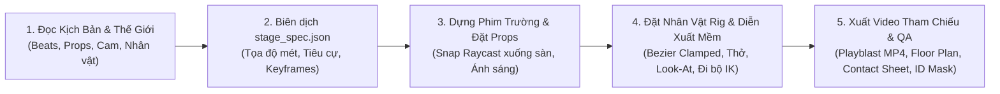

# Kỹ năng Đạo diễn Phim Trường 3D & Video Tham Chiếu (`g84-phim-truong-tham-chieu`)

> **Mục tiêu tối thượng:** Khi Showrunner đưa **Kịch bản phim + Kịch bản xây dựng thế giới + Props + Cảnh quay + Vị trí Cam + Nhân vật tham chiếu**, Cúc tự động dựng **Phim trường 3D nhỏ chuẩn tỷ lệ mét**, đặt **nhân vật sẵn Rig diễn xuất mượt chuẩn kỹ thuật**, và quay **Video Tham Chiếu Đa Kênh** để làm xương sống cho hậu kỳ AI hoặc duyệt đạo diễn.

---

## 1. Quy trình 5 Bước Tự Động (Từ Kịch Bản → Video Tham Chiếu)



### Bước 1: Chuyển Kịch bản thành Bản Thiết Kế Phim Trường (`stage_spec.json`)
- **Không gian (`world`):** Chọn mẫu khung phim trường (`room_l_shape` cho nội thất 2 vách mở để đặt máy quay thoải mái, `room_u_shape` cho phòng kín 3 vách, `alley` cho hẻm 2 vách kiểu *Hẻm Vít*, hoặc `open_floor` cho ngoại cảnh).
- **Đạo cụ (`props`):** Quy đổi mọi bàn, ghế, xe, quầy hàng, cột đèn sang kích thước mét thật (`dims`), gán màu định danh rõ ràng và bật `snap_to_ground: true` để bắn tia Raycast ép sát mặt sàn (cấm tuyệt đối đạo cụ bay lơ lửng).
- **Nhân vật (`characters`):**
  - Chiều cao thật (`1.65m – 1.80m`), hướng mặt chuẩn trục `-Y`, màu định danh tách biệt (`color_id`) để AI Video không bao giờ trộn 2 người làm 1.
  - Dùng `rigify_proxy` (nhân vật gắn sẵn bộ xương Rigify đầy đủ IK/FK) hoặc `mannequin` có khớp/hướng nhìn rõ ràng.
- **Chuyển động mềm chuẩn kỹ thuật (`keyframes` + `walk_path` + `look_at`):**
  - **Cấm nội suy tuyến tính (Linear) cứng đờ như robot:** Mọi chuyển động cơ thể và máy quay đều tự động đi qua bộ lọc `apply_smooth_bezier_clamped()` (`BEZIER` + `AUTO_CLAMPED`) hoặc `bx_anim.blocking_to_spline()` (giữ Moving Holds rồi mới nội suy đường cong).
  - **Nhịp thở sinh học (`add_breathing_and_idle_micro_motion`):** Tự động thêm dao động thở nhẹ ở lồng ngực/vai để nhân vật đứng nghe thoại vẫn sống động.
  - **Ánh nhìn tự nhiên (`add_head_look_at_constraint`):** Chia tỷ lệ `Damped Track` Cổ `35%` + Đầu `65%` hướng vào người đối thoại hoặc đạo cụ.
- **Máy quay & Cắt cảnh (`shots`):**
  - Mỗi cảnh quay (`Shot`) có 1 Camera riêng gắn vào `Timeline Marker` (`Bind Camera to Markers`), tự động chuyển máy đúng frame cắt.
  - Áp dụng tiêu cự chuẩn (`24mm` hẻm rộng, `35mm` cảnh đôi, `50mm` cảnh trung, `85mm` cận cảnh), phối cảnh 2 điểm tụ (`shift_y`) giữ tường thẳng đứng, và độ rung cầm tay siêu nhẹ (`handheld_strength = 0.005 - 0.012`).

---

## 2. Bộ Công Cụ Thực Thi (`scripts/`)

Toàn bộ script trong thư mục [`scripts/`](scripts/) đã được kiểm định trên **Blender 5.1 / 5.2+**:

| File Script | Chức năng cốt lõi |
| :--- | :--- |
| [`scripts/g84_stage_director.py`](scripts/g84_stage_director.py) | **Bộ máy tổng chỉ huy Gate 84:** Nhận `stage_spec.json`, dựng phim trường, đặt đạo cụ, gắn nhân vật Rig, tạo chuyển động mượt, đặt đa Camera, kiểm định QA và xuất toàn bộ gói Video Tham Chiếu. |
| [`scripts/bx_previs.py`](scripts/bx_previs.py) | Thư viện Previs & Storyboard (1,419 dòng): `setup_scene`, `prop`, `mannequin`, `rigify_proxy`, `pose`, `place_camera`, `build_shots`, `handheld`, `floor_plan`, `contact_sheet`, `animatic`, `line_of_sight`, `audit`. |
| [`scripts/bx_blockout.py`](scripts/bx_blockout.py) | Thư viện Blockout cho AI Video (758 dòng): `rail_camera`, `key_rail`, `bind_cuts`, `audit_cuts`, `audit_framing`, `audit_occlusion`, `audit_intersections`, `audit_ground`, `state_audit`. |
| [`scripts/bx_kits.py`](scripts/bx_kits.py) | Thư viện Kitbash & Đám đông (1,239 dòng): `building`, `tree`, `vehicle`, `stall`, `street_lamp`, `figure`, `walk_path` (tự tính chu kỳ bước chân IK theo quãng đường), `crowd`, `drive`, `pedal`. |
| [`scripts/bx_anim.py`](scripts/bx_anim.py) | Thư viện Hoạt hình chuyên sâu Blender 5.2 (2,142 dòng): Xử lý `channelbag` Slotted Action, `blocking_to_spline`, `auto_holds`, `ease_inbetweens`, `foot_slip`, `limb_extension` (bắt lỗi giật khớp gối), `onion_skin`, `graph_image`. |
| [`scripts/bx_rig.py`](scripts/bx_rig.py) | Thư viện Rigging & Skinning (3,120 dòng): `fit_metarig`, `upgrade_face`, `generate`, `bind` (tự động fallback sang Voxel Proxy nếu Bone Heat lỗi), `clean_weights`, `deformation_report`, `pose_sheet`, `shape_set("arkit")`. |
| [`scripts/bx_audit.py`](scripts/bx_audit.py) & [`scripts/bx_review.py`](scripts/bx_review.py) | Kiểm định hình học (`audit`, `deliverable`) và xuất nhanh video `playblast`, `turntable`, `review` 4 góc. |
| [`scripts/qa_check.py`](scripts/qa_check.py) & [`scripts/review_shots.py`](scripts/review_shots.py) | Quét lỗi z-fighting, mesh bay lơ lửng, ngược normal và chụp ảnh nghiệm thu đa góc. |

---

## 3. Lệnh Chạy Nhanh (Headless CLI)

```powershell
blender -b -P "d:\G84 - brain\Brain - G84\Gate84-Brain\.agent\skills\g84-phim-truong-tham-chieu\scripts\g84_stage_director.py" -- --spec "path/to/stage_spec.json" --out "path/to/output_dir"
```

## 4. Đầu Ra Chuẩn Của Một Phiên Dựng Phim Trường
1. **`<SceneName>.blend`**: File Blender 5.2 chứa toàn bộ phim trường, đạo cụ, nhân vật sẵn rig, animation và hệ thống Camera đã bind vào Timeline Markers.
2. **`01_TopDown_FloorPlan.png`**: Bản vẽ mặt bằng nhìn từ trên xuống (thấy rõ tường, đạo cụ, quỹ đạo nhân vật, hình nón góc nhìn của từng Camera và trục 180 độ).
3. **`02_ContactSheet_Shots.png`**: Bảng tổng hợp các khung hình Đầu – Giữa – Cuối của toàn bộ các cảnh quay để duyệt bố cục ngay lập tức.
4. **`<SceneName>_Reference_Playblast.mp4`**: Video tham chiếu chuyển động mượt chuẩn tốc độ khung hình (`24fps` / `30fps`, số frame `8n+1` khớp chuẩn LTX-2.5 / Wan 2.1).
5. **`passes/Shot_XXX_IDMask_fXXXX.png` & `Shot_XXX_Shaded_fXXXX.png`**: Bộ ảnh Mask tách màu định danh và ảnh Shaded đầu/giữa/cuối cho từng cảnh quay.
6. **`STAGE_HANDOFF_REPORT.json`**: Báo cáo kiểm định tự động (Framing, Occlusion, Line of Sight, 180-degree axis) và thông số bàn giao sang pipeline AI Video.

---

## 5. Kiến Trúc Biên Đạo Hành Động Võ Hiệp 30 Giây (`G84 Action Production Architecture`)
- Xem chi tiết quy chuẩn **World Lock + 8-Beat Split + Contact Event Manifest + Continuity QA cho Seedance/AI Video** tại: [`references/g84_action_engine_architecture.md`](references/g84_action_engine_architecture.md).
