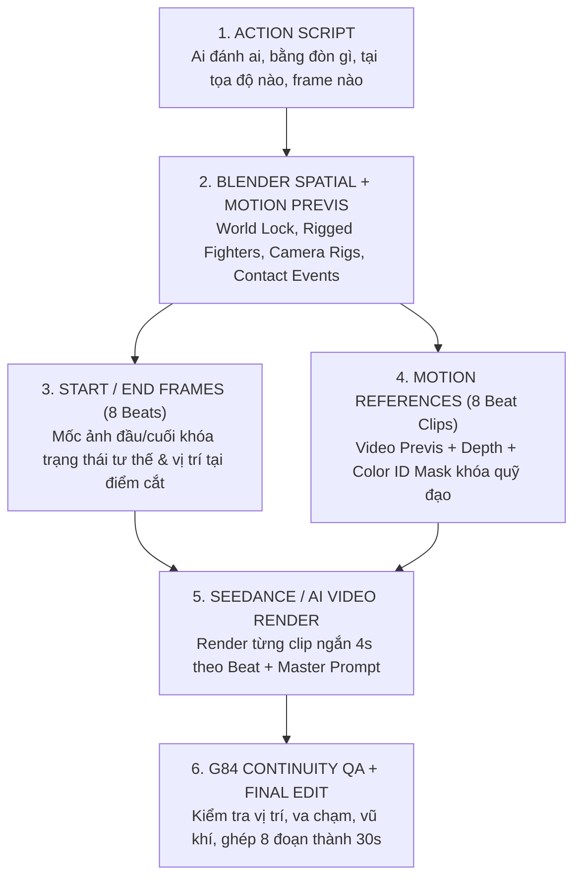

# G84 ACTION PRODUCTION ARCHITECTURE (Chuẩn Biên Đạo Võ Thuật 3D → AI Video / Seedance)

> **Nguyên lý cốt lõi của Showrunner Gate 84:**
> - **Blender nắm 100% quyền quyết định về không gian và biên đạo chuyển động** (vị trí nhân vật, hướng di chuyển, thời điểm tiếp xúc đòn đánh, phá hủy môi trường có điều kiện, góc máy).
> - **AI Video (Seedance / LTX-2.5 / Wan / MiniMax H3) KHÔNG ĐƯỢC tự sáng tác lại** vị trí nhân vật, hướng di chuyển hay diễn biến trận đánh; AI chỉ chịu trách nhiệm phủ ngoại hình, chất liệu, ánh sáng, khí quyển và độ chi tiết thực tế lên bộ khung previs của Blender.
> - **Chiến lược Chia Để Trị (8 Clip × 4 Giây = 30 Giây):** Dựng liền mạch 30 giây (`720 frames @ 24fps`) trong 1 file Blender duy nhất để khóa chặt tính liên tục không gian (World Lock), nhưng **xuất thành 8 đoạn clip ngắn theo từng Beat** kèm Start/End Frame và trạng thái nối tiếp để AI Video không bị trôi nhân vật hay biến dạng bối cảnh.

---

## 1. Kiến Trúc 6 Tầng (G84 Action Production Pipeline)

---

## 2. Luật Bất Di Bất Dịch Khi Dựng Previs Hành Động Trong Blender

1. **World Lock (Khóa Tọa Độ Thế Giới):**
   - Gốc tọa độ `(0, 0, 0)` tại trung tâm sàn đấu; trục `+X` = Đông, `+Y` = Bắc, `+Z` = Lên trên.
   - Toàn bộ tường, cột đá (`P1`), bàn thờ (`Altar`), tượng Phật (`Buddha`), cửa ra vào và hướng nắng chỉ dựng 1 lần và giữ nguyên xuyên suốt 720 frames.
2. **Identity & Weapon Continuity (Khóa Định Danh & Vũ Khí):**
   - Số lượng võ sĩ cố định tuyệt đối (ví dụ: 4 người `W`, `A`, `B`, `C`), mỗi người một màu định danh (`Color ID`) tách biệt.
   - Vũ khí (kiếm thẳng / đao cong) phải gắn (`Child Of` hoặc `Bone Parent`) vào xương bàn tay của chủ sở hữu, giữ hướng lưỡi kiếm liên tục, không bao giờ tự biến mất hay đổi chủ nếu kịch bản không yêu cầu.
3. **Physical Action & Contact Rules (Luật Va Chạm Vật Lý Có Kiểm Chứng):**
   - Mọi đòn đánh phải đủ 5 pha: **Chuẩn bị (Preparation / Weight Transfer) → Quỹ đạo (Trajectory) → Điểm tiếp xúc (Contact Frame & Proximity) → Phản ứng trúng đòn (Opponent Reaction) → Điểm dừng vật lý (Endpoint)**.
   - Đối thủ ngã xuống phải **nằm yên tại đúng tọa độ bị hạ** cho đến hết frame 720 (không tự biến mất, không dịch chuyển tức thời).
   - **Phá hủy có điều kiện (Causal Destruction):** Đạo cụ (như bàn thờ gỗ `Altar`) giữ nguyên khối từ frame `1` đến đúng `Contact Frame` khi cơ thể `C` va vào mới kích hoạt tách mảnh vỡ (`Debris`) và bụi.
4. **Camera Axis & Readability (Giữ Trục Chiến Đấu & Đọc Rõ Động Tác):**
   - Chỉ dùng ống kính `35mm` (toàn cảnh/di chuyển) và `50mm` (trung/cận hành động).
   - Mỗi Beat chỉ có **1 tuyến va chạm chính**; mọi cú chuyển máy (`CAM_A`, `CAM_B`, `CAM_C`, `CAM_D`) phải bảo toàn địa lý ngôi chùa và trục hướng nhìn (180-degree combat axis).

---

## 3. Bộ Đầu Ra Bắt Buộc (Deliverables Contract)

Mỗi dự án Action Previs 30 giây (`720 frames @ 24fps`) phải sinh ra đủ:
1. **`temple_action_previs.blend`**: File Blender 5.2 hoàn chỉnh (World + 4 Rigged Fighters + Swords + Animated Altar Destruction + CAM_A/B/C/D + Timeline Event Markers).
2. **`temple_action_previs.mp4`** + **8 file clip lẻ `beat_01.mp4` .. `beat_08.mp4`**: Video previs toàn cảnh 30s và 8 đoạn cắt riêng theo từng Beat để nạp vào Seedance / AI Video.
3. **`Reference_Frames/`**: Ảnh tham chiếu tại tất cả ranh giới 8 Beat (`Start` / `Contact` / `End` của từng Beat) để khóa trạng thái nối cảnh.
4. **`choreography_timeline.json`**: Bảng kê chi tiết 8 Beat, frame bắt đầu/kết thúc, các `Contact Events` (frame va chạm, khoảng cách thực tế tính bằng mét giữa 2 võ sĩ tại frame va chạm).
5. **`camera_manifest.json`**: Thông số tiêu cự, tọa độ đầu/cuối, góc nhìn của `CAM_A`, `CAM_B`, `CAM_C`, `CAM_D` trên từng Beat.
6. **`continuity_report.json`**: Báo cáo kiểm định hình học tự động:
   - Kiểm tra dịch chuyển tức thời (`max_step_distance_m` giữa 2 frame liên tiếp).
   - Kiểm tra khoảng cách tại frame trúng đòn (`contact_proximity_m`).
   - Kiểm tra bàn thờ chỉ vỡ sau frame va chạm (`altar_intact_before_impact: true`).
   - Kiểm tra đối thủ bị hạ giữ nguyên vị trí đến frame 720.
